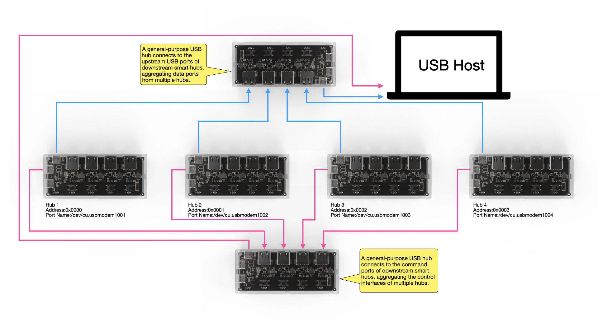
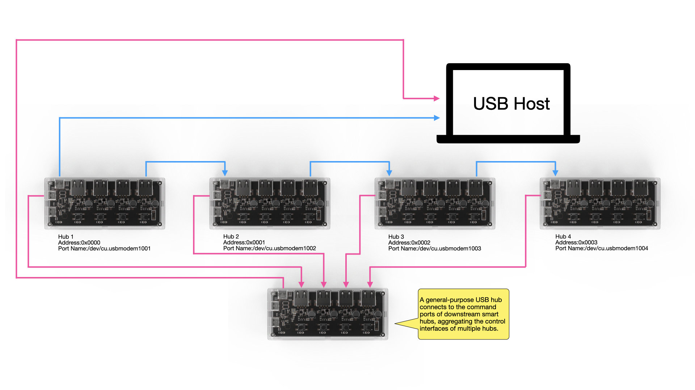

# SmartUSBHub Communication Protocol

## Introduction

SmartUSBHub communicates with the host through its USB CDC command port. This document describes the shared serial settings, protocol frame format, complete command set, and command examples for the SmartUSBHub family. Channel counts and optional capabilities vary by product; the channel values and frames below primarily use a four-channel model as the example.

[简体中文](./protocol_cn.md) · [Download PDF](./downloads/protocol-en.pdf) · [Product documentation](./README.md) · [Python SDK](../README.md)

## Document navigation

- [Frame formats](#frame-formats)
  - [Fixed-length frame: one data byte](#fixed-length-frame-one-data-byte)
  - [Fixed-length frame: two data bytes](#fixed-length-frame-two-data-bytes)
  - [Variable-length frame](#variable-length-frame)
- [Command reference](#command-reference)
  - [Channel control](#channel-control)
  - [Measurement and monitoring](#measurement-and-monitoring)
  - [Alerts and protection](#alerts-and-protection)
  - [Default states](#default-states)
  - [Device configuration](#device-configuration)
  - [Device information and discovery](#device-information-and-discovery)
  - [Appendix: frame checksums and construction](#appendix-frame-checksums-and-construction)
- [Glossary](#glossary)

## Frame formats

SmartUSBHub uses V1, V2, and V3 frames on the same serial link. Offsets and sizes in the layouts below are measured in bytes.

### Fixed-length frame: one data byte

| Offset | Field | Size | Description |
| ---: | --- | ---: | --- |
| 0 | SOF1 | 1 | Fixed `0x55` |
| 1 | SOF2 | 1 | Fixed `0x5A` |
| 2 | CMD | 1 | Command code |
| 3 | CHANNEL | 1 | Channel bitmask; bit 0 is channel 1 |
| 4 | VALUE | 1 | One-byte command argument or status |
| 5 | SUM8 | 1 | `(CMD + CHANNEL + VALUE) & 0xFF` |

V1 is always 6 bytes and carries most set, query, and acknowledgement messages.

### Fixed-length frame: two data bytes

| Offset | Field | Size | Description |
| ---: | --- | ---: | --- |
| 0–1 | SOF | 2 | Fixed `55 5A` |
| 2 | CMD | 1 | Command code |
| 3 | CHANNEL | 1 | Channel bitmask |
| 4 | VALUE0 | 1 | High byte of voltage/current, or the `enable` field |
| 5 | VALUE1 | 1 | Low byte of voltage/current, or the `status` field |
| 6 | SUM8 | 1 | `(CMD + CHANNEL + VALUE0 + VALUE1) & 0xFF` |

V2 is always 7 bytes. It currently carries voltage/current replies and default power/data-line states that need two data bytes. Parse a 16-bit measurement as `VALUE0 << 8 | VALUE1`.

### Variable-length frame

| Offset | Field | Size | Description |
| ---: | --- | ---: | --- |
| 0–3 | MAGIC | 4 | Fixed `55 AB CD EF` |
| 4 | CMD | 1 | Command code |
| 5 | FLAGS | 1 | `04` request, `02` response, `01` event |
| 6–7 | LENGTH | 2 | Payload length, little-endian: `LEN_L, LEN_H` |
| 8–9 | CRC16 | 2 | Little-endian: `CRC_L, CRC_H` |
| 10–11 | REQUEST_ID | 2 | Request ID, little-endian |
| 12 | STATUS | 1 | Common status code |
| 13–15 | RESERVED | 3 | Must be zero |
| 16… | PAYLOAD | LENGTH | Command-specific variable data |

The fixed header is 16 bytes, the payload limit is 1024 bytes and the complete frame limit is 1040 bytes. CRC covers the complete header and payload with bytes 8–9 zeroed.

Exactly one `FLAGS` value is allowed: `0x04` request, `0x02` response, `0x01` event.
Requests use a nonzero 16-bit request ID; responses echo the command and ID.
Events have ID/status zero. The serial-number body solicited by a V1 `0xF9`
query is the sole zero-ID response. Current reserved bytes must be zero.
A nonzero reserved request field is rejected as an invalid argument. Unknown
message-type flags are never executed. No automatic operation replay or deduplication
is implied by an ID; a host must not blindly retry non-idempotent operations.

| STATUS | SDK constant | Meaning |
| --- | --- | --- |
| 0 | `V3_STATUS_OK` | OK |
| 1 | `V3_STATUS_UNSUPPORTED_COMMAND` | Unsupported command |
| 2 | `V3_STATUS_UNSUPPORTED_FEATURE` | Unsupported feature on this product |
| 3 | `V3_STATUS_INVALID_ARGUMENT` | Invalid argument |
| 4 | `V3_STATUS_BUSY` | Busy |
| 5 | `V3_STATUS_NOT_READY` | Not ready |
| 6 | `V3_STATUS_IO_ERROR` | I/O error |
| 7 | `V3_STATUS_INTERNAL_ERROR` | Internal error |

#### Control and configuration failures

Successful replies retain their existing framing and payloads. Current firmware
reports these failures explicitly:

| Commands | Failure reply |
| --- | --- |
| `0x01` power control | V1 `CHANNEL=FF, VALUE=FF` for interlock rejection, a busy power operation, protection refusal or a GPIO write failure |
| `0x02` interlock selection | V1 `VALUE=FF` for a busy power operation, protection refusal or a GPIO write failure |
| `0x06` mode, `0x09` buttons, `0x0F` state persistence, `0xFC` factory reset | V1 `CHANNEL=FF, VALUE=FF` when the operation cannot be completed or saved |
| `0x0B` default power, `0x0D` default USB2 data | V2 `CHANNEL=FF, VALUE0=FF, VALUE1=FF` when saving fails |
| `0x1E` channel name, `0x20` device alias, `0x2D` default USB3 data | V3 `STATUS=6` (`IO_ERROR`), empty payload, when saving fails |
| `0x11` device address | No ACK when saving fails; the host times out. `FF/FF` remains a valid success echo for address `0xFFFF` |

The SDK returns `False` for these rejected setter operations, preserves prior
configuration caches and does not treat an explicit rejection as a communication
timeout. Address setters also require the echoed address to match the request.
Legacy V1/V2 frames have no request ID and cannot distinguish a delayed reply to
an identical earlier request.

Failed saves restore the affected RAM settings and attempt to restore the
previous Flash page. Repeated Flash failures and power loss during the single-page
erase/write process can still lose persisted settings. A failed factory reset
does not apply default output states. Power commands may have partly applied;
after a rejected control command, read actual output states before continuing.

Command data is interpreted only on success; error data may contain command-specific
diagnostics. JSON is UTF-8 without a terminating NUL and is used only where the
command specifies it. Binary optional fields require explicit request flags or
length-delimited extension blocks. No heuristic JSON/binary detection is used.

The SDK matches responses by `(CMD, REQUEST_ID)`, ignores unmatched responses,
and retires timed-out requests. Only one outstanding SDK request per command is
supported. IDs skip zero, active IDs and IDs used in the last 60 seconds; device
responses must not be retained beyond this interval. Active events never satisfy
ACK waits. `last_protocol_error` exposes the most recent rejection; existing boolean
query/set APIs report failure without triggering timeout recovery for a rejection.

Partial receive frames expire after 250 ms of idle time in the SDK and 20 ms in
the current MCU parser; these are inter-byte limits, separate from command response
timeouts (including slow authentication). A valid unknown command receives status 1;
bad CRC frames are discarded. CDC splits a frame into endpoint packets.

## Command reference

> [!NOTE]
>
> - All data values below are in hexadecimal.
> - Channel values use the `Channel_e` enum, not the channel number. In control and query commands, bitwise OR can be used for batch control and query; if the device is in *interlock* mode, only the `interlock control command [0x02]` can be used for control; bitwise combination is ineffective.
> - Frames with a bad checksum or incorrect format are silently dropped and receive no response; an unknown command returns an echo frame with the command code and channel/value both set to FF.
> - When a button is pressed, a `status report [0x00] command` of that channel’s current state will be sent.
> - The provided package includes a UART assistant tool (uart_tool) for quick start.
> - A Python control library [smartusbhub](https://github.com/mixedsignal-labs/smartusbhub) is available.
> - In this document, USB downstream port is referred to simply as a channel.


**Channel Enum Values (Channel_e):**

```c
typedef enum
{
    CH1 = 0x01,
    CH2 = 0x02,
    CH3 = 0x04,
    CH4 = 0x08,
    CH5 = 0x10,
    CH6 = 0x20,
    CH7 = 0x40,
}Channel_e;

```
The available channels depend on the product model: four-channel products use CH1 through CH4, while seven-channel products use CH1 through CH7.

> [!NOTE]
>
> **Device Communication Parameters:**
>
> - Baud Rate: 115200 – 921600 (Default: `115200`)
>
> - Data Bits: `8`
>
> - Parity: `None`
>
> - Stop Bits: `1`
>
> **Device Name:**
>
> - Windows: `COMx`
>
> - Linux: `/dev/ttyACMx`
>
> - macOS: `/dev/cu.usbmodemx`


------

### Channel control

| Command | Code | Description |
| --- | --- | --- |
| Control channel power | 0x01 | Control the selected channel’s VBUS power |
| Query channel power | 0x00 | Read whether the selected channel’s VBUS power is on |
| Control power in interlock mode | 0x02 | Select the only powered channel in interlock mode |
| Control USB2.0 data | 0x05 | Connect or disconnect a channel’s USB2.0 data link |
| Query USB2.0 data state | 0x08 | Read a channel’s USB2.0 data-link state |
| Control USB3.0 data | 0x15 | Connect or disconnect a channel’s USB3.0 data link |
| Query USB3.0 data state | 0x16 | Read a channel’s USB3.0 data-link state |
| Set upstream host | 0x22 | Select the upstream host |
| Get upstream host | 0x23 | Read the selected upstream host |
| Query all channel power states | 0x36 | Return a whole-device power-state bitmask in one frame |
| Query all USB2 data states | 0x37 | Return a whole-device USB2 data-state bitmask in one frame |
| Query all USB3 data states | 0x38 | Return a whole-device USB3 data-state bitmask in one frame |

#### **Control Channel Power Switch (CMD: 0x01)**

> [!NOTE]
>
> If the device is in interlock mode, the normal control command (CMD: 0x01) is ineffective; you must use the interlock control command (CMD: 0x02) instead.
>
> If a control command is sent in interlock mode, an “invalid command” frame will be returned:
>
> *Invalid Command:*
>
> ```
> 55 5A 01 FF FF FF
> ```

##### **Data Field Description:**

| data[0]     | data[1]             |
| ----------- | ------------------- |
| Channel ID  | Channel Power State |
| `Channel_e` | 0 (OFF), 1 (ON)     |


##### **Turn On Channel 1 Power**

**Command**:

```
55 5A 01 01 01 03
```

**Response**:

```
55 5A 01 01 01 03
```

##### **Turn Off Channel 1 Power**

**Command**:

```
55 5A 01 01 00 02
```

**Response**:

```
55 5A 01 01 00 02
```


##### **Turn On Channel 2 Power**

**Command**:

```
55 5A 01 02 01 04
```

**Response**:

```
55 5A 01 02 01 04
```

##### **Turn Off Channel 2 Power**

**Command**:

```
55 5A 01 02 00 03
```

**Response**:

```
55 5A 01 02 00 03
```


##### **Turn On Channel 3 Power**

**Command**:

```
55 5A 01 04 01 06
```

**Response**:

```
55 5A 01 04 01 06
```

##### **Turn Off Channel 3 Power**

**Command**:

```
55 5A 01 04 00 05
```

**Response**:

```
55 5A 01 04 00 05
```


##### **Turn On Channel 4 Power**

**Command**:

```
55 5A 01 08 01 0A
```

**Response**:

```
55 5A 01 08 01 0A
```

##### **Turn Off Channel 4 Power**

**Command**:

```
55 5A 01 08 00 09
```

**Response**:

```
55 5A 01 08 00 09
```


##### **Combined Control Example**

##### **Turn On Channel 1 and Channel 3 Power**

**Command**:

```
55 5A 01 05 01 07
```

**Response**:

```
55 5A 01 05 01 07
```

##### **Turn Off Channel 1 and Channel 3 Power**

**Command**:

```
55 5A 01 05 00 06
```

**Response**:

```
55 5A 01 05 00 06
```

##### **Turn On All Channels**

**Command**:

```
55 5A 01 0F 01 11
```

**Response**:

```
55 5A 01 0F 01 11
```

##### **Turn Off All Channels**

**Command**:

```
55 5A 01 0F 00 10
```

**Response**:

```
55 5A 01 0F 00 10
```

##### Multi-channel power-on staggering

`device.power_on_stagger_ms`, when present, declares the firmware-controlled gap between selected channels in a multi-channel ON command (USB3 four-port: 1ms). Single-channel and OFF commands add no such delay. This is read-only product configuration, with no app setting or additional host-side delay.

#### **Query Channel Power State (CMD: 0x00)**

##### **Data Field Description:**

| data[0]     | data[1]             |
| ----------- | ------------------- |
| Channel ID  | Channel Power State |
| `Channel_e` | 0 (OFF), 1 (ON)     |


##### **Query Channel 1 Power State**

**Command**:

```
55 5A 00 01 00 01
```

**Response**:

**If channel 1 power is OFF**:

```
55 5A 00 01 00 01
```

**If channel 1 power is ON**:

```
55 5A 00 01 01 02
```


##### **Query Channel 2 Power State**

**Command**:

```
55 5A 00 02 00 02
```

**Response**:

**If channel 2 power is OFF**:

```
55 5A 00 02 00 02
```

**If channel 2 power is ON**:

```
55 5A 00 02 01 03
```


##### **Query Channel 3 Power State**

**Command**:

```
55 5A 00 04 00 04
```

**Response**:

**If channel 3 power is OFF**:

```
55 5A 00 04 00 04
```

**If channel 3 power is ON**:

```
55 5A 00 04 01 05
```


##### **Query Channel 4 Power State**

**Command**:

```
55 5A 00 08 00 08
```

**Response**:

**If channel 4 power is OFF**:

```
55 5A 00 08 00 08
```

**If channel 4 power is ON**:

```
55 5A 00 08 01 09
```


##### **Combined Control Example**:

##### **Query All Channels’ Power States**

**Command**:

```
55 5A 00 0F 00 0F
```

**Response**:

```
55 5A 00 01 01 02
55 5A 00 02 00 02
55 5A 00 04 00 04
55 5A 00 08 01 09
```

- **Channel 1 Power: ON**

- **Channel 2 Power: OFF**

- **Channel 3 Power: OFF**

- **Channel 4 Power: ON**

#### Control channel USB2.0 data (CMD: 0x05)

The device can control the connectivity of the D+ and D− differential pair for a specified channel, allowing scenarios where power is maintained but data is disconnected.

> [!NOTE]
>
> - By default, each channel’s USB data (D+/D−) lines are connected unless the user sends a control command (CMD: 0x05) to manually disconnect them.
>
> - If power-loss state Persistence is enabled, the data line on/off state will be remembered.

##### **Data Field Description:**

| data[0]     | data[1]                 |
| ----------- | ----------------------- |
| Channel ID  | Channel Data Line State |
| `Channel_e` | 0 (OFF), 1 (ON)         |


##### **Connect Channel 1 Data Lines**

**Command**:

```
55 5A 05 01 01 07
```

**Response**:

```
55 5A 05 01 01 07
```

##### **Disconnect Channel 1 Data Lines**

**Command**:

```
55 5A 05 01 00 06
```

**Response**:

```
55 5A 05 01 00 06
```


##### **Connect Channel 2 Data Lines**

**Command**:

```
55 5A 05 02 01 08
```

**Response**:

```
55 5A 05 02 01 08
```

##### **Disconnect Channel 2 Data Lines**

**Command**:

```
55 5A 05 02 00 07
```

**Response**:

```
55 5A 05 02 00 07
```


##### **Connect Channel 3 Data Lines**

**Command**:

```
55 5A 05 04 01 0A
```

**Response**:

```
55 5A 05 04 01 0A
```

##### **Disconnect Channel 3 Data Lines**

**Command**:

```
55 5A 05 04 00 09
```

**Response**:

```
55 5A 05 04 00 09
```


##### **Connect Channel 4 Data Lines**

**Command**:

```
55 5A 05 08 01 0E
```

**Response**:

```
55 5A 05 08 01 0E
```

##### **Disconnect Channel 4 Data Lines**

**Command**:

```
55 5A 05 08 00 0D
```

**Response**:

```
55 5A 05 08 00 0D
```


##### **Combined Control Example**:

##### **Connect Data Lines on All Channels**

**Command**:

```
55 5A 05 0F 01 15
```

**Response**:

```
55 5A 05 0F 01 15
```

##### **Disconnect Data Lines on All Channels**

**Command**:

```
55 5A 05 0F 00 14
```

**Response**:

```
55 5A 05 0F 00 14
```

#### Query channel USB2.0 data state (CMD: 0x08)

##### **Data Field Description:**

| data[0]     | data[1]                 |
| ----------- | ----------------------- |
| Channel ID  | Channel Data Line State |
| `Channel_e` | 0 (OFF), 1 (ON)         |


##### **Query Channel 1 Data Line State**

**Command**:

```
55 5A 08 01 00 09
```

**Response**:

**If channel 1 data is DISCONNECTED**:

```
55 5A 08 01 00 09
```

**If channel 1 data is CONNECTED**:

```
55 5A 08 01 01 0A
```


##### **Query Channel 2 Data Line State**

**Command**:

```
55 5A 08 02 00 0A
```

**Response**:

**If channel 2 data is DISCONNECTED**:

```
55 5A 08 02 00 0A
```

**If channel 2 data is CONNECTED**:

```
55 5A 08 02 01 0B
```


##### **Query Channel 3 Data Line State**

**Command**:

```
55 5A 08 04 00 0C
```

**Response**:

**If channel 3 data is DISCONNECTED**:

```
55 5A 08 04 00 0C
```

**If channel 3 data is CONNECTED**:

```
55 5A 08 04 01 0D
```


##### **Query Channel 4 Data Line State**

**Command**:

```
55 5A 08 08 00 10
```

**Response**:

**If channel 4 data is DISCONNECTED**:

```
55 5A 08 08 00 10
```

**If channel 4 data is CONNECTED**:

```
55 5A 08 08 01 11
```


##### **Combined Control Example**:

##### **Combined Control Example: Query All Channels’ Data Line States**

**Command**:

```
55 5A 08 0F 00 17
```

**Response**:

```
55 5A 08 01 01 0A
55 5A 08 02 01 0B
55 5A 08 04 01 0D
55 5A 08 08 01 11
```

- **Channel 1 Data: CONNECTED**

- **Channel 2 Data: CONNECTED**
- **Channel 3 Data: CONNECTED**
- **Channel 4 Data: CONNECTED**

#### **Control channel USB3.0 data (CMD: 0x15)**

The channel field is a bitmask, as with other control commands, and supports bitwise combinations (CH1=01, CH2=02, CH3=04, CH4=08).

##### **Data field description:**

| data[0] | data[1] |
| --- | --- |
| Channel bitmask | 01=connected / 00=disconnected |

**Connect channel 1 USB3.0 data**:

```
55 5A 15 01 01 17
```

**Response**:

```
55 5A 15 01 01 17
```

**Disconnect channel 1 USB3.0 data**:

```
55 5A 15 01 00 16
```

**Response**:

```
55 5A 15 01 00 16
```

**Connect all channels’ USB3.0 data**:

```
55 5A 15 0F 01 25
```

**Response**:

```
55 5A 15 0F 01 25
```

#### **Query channel USB3.0 data state (CMD: 0x16)**

##### **Data field description:**

| data[0] | data[1] |
| --- | --- |
| Channel bitmask | 00 (query) |

**Query channel 1 USB3.0 data state**:

```
55 5A 16 01 00 17
```

**Response** (01=connected):

```
55 5A 16 01 01 18
```

**Query all channels’ USB3.0 data states** (the aggregate query CMD: 0x38 is recommended for batch queries):

```
55 5A 16 0F 00 25
```

**Response** (one frame per channel, in ascending channel order):

```
55 5A 16 01 01 18
55 5A 16 02 01 19
55 5A 16 04 01 1B
55 5A 16 08 01 1F
```

#### Whole-device switch status masks (CMD: 0x36 / 0x37 / 0x38)

Protocol API 1.3.0 adds three six-byte V1 queries. Each reply contains one switch state for every channel.

| Command | Code | Meaning of a set bit |
| --- | --- | --- |
| Get channel power mask | `0x36` | Power switch enabled |
| Get channel USB2 data mask | `0x37` | USB2 data switch connected |
| Get channel USB3 data mask | `0x38` | USB3 data switch connected |

Cache the `0x2B` summary and use these commands only when `channel_status_mask` is explicitly `true`.
USB2/USB3 queries also require `usb2_data_switch` / `usb3_data_switch` respectively.
Devices with a missing declaration or field use the existing per-channel `0x00` / `0x08` / `0x16` queries.

| Offset | Request | Response |
| --- | --- | --- |
| 0–1 | `55 5A` | `55 5A` |
| 2 | Command | Echoed command |
| 3, channel | `00` | Low eight mask bits |
| 4, data | `00` | High eight mask bits |
| 5 | `(cmd + channel + data) & 0xFF` | Same checksum algorithm |

Decode the mask as `channel | (data << 8)`. Bit 0 represents channel 1 and bit 9 represents channel 10,
with capacity for 16 channels. Obtain the actual count from the declaration or maximum-channel query.
Bits above that count must be zero. Every request returns all channels and the SDK filters requested subsets.

A power query is `55 5A 36 00 00 36`. With channels 1, 3 and 9 enabled, the mask is `0x0105`
and the reply is `55 5A 36 05 01 3C`.

Values report GPIO switch logic readback. Measurement APIs provide port voltage/current and the host provides
USB enumeration status. Each command reads all channels inside a short critical section.
The three commands have separate acquisition times. Reading all three takes three frames, totaling 18 bytes.
Default configuration uses its existing APIs.

Invalid arguments or unsupported features use the V1 rejection reply with `channel=data=FF`.
A GPIO read failure abandons the entire reply and the host reports a timeout.
For 16-channel devices `FFFF` is also a valid all-on mask, so callers must verify capabilities first
and always send the specified zero arguments.

`get_channel_power_status()`, `get_channel_usb2_dataline_status()` and `get_channel_usb3_dataline_status()`
automatically select the transport. Omitting channels queries every channel. A single power query returns
an integer, multiple power queries and USB data queries return dictionaries.
An aggregate response updates the full channel cache and invokes existing per-channel status callbacks,
whose channel argument remains a channel bitmask. Aggregate timeout or invalid replies return `None`.

The legacy path and default-power/default-USB2 queries clear requested stale cache entries and wait for all
replies or the timeout. Existing partial-result behavior is retained, returning only channels received during
the current query and logging missing channels. No received channels yields `None`.
Callers should verify that returned keys cover their requested channels. Legacy channel fields address
channels 1 through 8, while higher-channel status queries require aggregate support.

New firmware continues to support existing per-channel commands for older SDKs and scripts.
The new SDK uses the compatibility path with older firmware and enables aggregation after a capable upgrade.

#### **Control Power in Interlock Mode (CMD: 0x02)**

> [!IMPORTANT]
> In interlock mode, use only this command to select the powered channel; the regular power command (CMD: 0x01) cannot control channels. Turning a channel's power off also disconnects its data line. CMD: 0x02 itself controls power; use the data-line command (CMD: 0x05) when the selected channel's USB2 data line also needs to be controlled.
>
> The interlock command powers the lowest-numbered channel in the mask and turns all other channels off; a mask of 0 turns off every channel. data[1] does not affect switching and is only echoed back.

**Control Truth Table:**

| **Channel 1** | **Channel 2** | **Channel 3** | **Channel 4** |
| ------------- | ------------- | ------------- | ------------- |
| Closed        | Closed        | Closed        | Closed        |
| **Open**      | Closed        | Closed        | Closed        |
| Closed        | **Open**      | Closed        | Closed        |
| Closed        | Closed        | **Open**      | Closed        |
| Closed        | Closed        | Closed        | **Open**      |

##### **Data Field Description:**

| data[0]     | data[1]             |
| ----------- | ------------------- |
| Channel ID  | Channel Power State |
| `Channel_e` | 0 (OFF), 1 (ON)     |


##### **Turn On Channel 1 Power (others off)**

**Command**:

```
55 5A 02 01 01 04
```

**Response**:

```
55 5A 02 01 01 04
```


##### **Turn On Channel 2 Power (others off)**

**Command**:

```
55 5A 02 02 01 05
```

**Response**:

```
55 5A 02 02 01 05
```


##### **Turn On Channel 3 Power (others off)**

**Command**:

```
55 5A 02 04 01 07
```

**Response**:

```
55 5A 02 04 01 07
```


##### **Turn On Channel 4 Power (others off)**

**Command**:

```
55 5A 02 08 01 0B
```

**Response**:

```
55 5A 02 08 01 0B
```


##### **Turn Off All Channels**

Mask 0 turns off every channel:

**Command**:

```
55 5A 02 00 00 02
```

**Response**:

```
55 5A 02 00 00 02
```

#### Set and get upstream host selection (CMD: 0x22 / 0x23)

Firmware1.0.0, product type=0x04: V1 SET=0x22, GET=0x23; channel=0.
SET data: 1=Host1, 2=Host2. GET request data=0.
Success: channel=0, data=actual selection. Failure: FF/FF.
Current firmware accepts Host1/Host2 only and persists the selection in App Flash. Legacy firmware accepted 0 (disconnect) and did not persist selection. Unset or factory-reset parameters select Host1.
USB3 port data control uses 0x15/0x16 and a port bitmask.

[Chinese SDK integration guide](products/usb3_4p/sdk_cn.md)

### Measurement and monitoring

| Command | Code | Description |
| --- | --- | --- |
| Query channel voltage | 0x03 | Read channel VBUS voltage in mV |
| Query channel current | 0x04 | Read channel current in mA |
| Batch measurements and streaming | 0x1A | Read voltage/current/power in batches, or enable/disable the measurement stream |
| Query board temperature | 0x25 | Read board temperature in 0.01 °C |
| Batch capture records | 0x28 | Measurement-stream batches with power records on supported models |
| Measurement filter | 0x29 | Instantaneous/eight-point averaging settings on supported models |

#### **Query Channel Voltage (CMD: 0x03)**


> [!NOTE]
>
> - The device can measure the output voltage (VBUS) of each channel, which can be used to check if the bus is functioning normally.
> - The voltage unit is mV (millivolts).
> - Voltage resolution is 1 mV

##### **Data Field Description:**

| data[0]     | data[1]                     | data[2]                    |
| ----------- | --------------------------- | -------------------------- |
| Channel ID  | Channel Voltage value[15:8] | Channel Voltage value[7:0] |
| `Channel_e` | -                           | -                          |


##### **Query Channel 1 Voltage**:

**Command**:

```
55 5A 03 01 00 04
```

**Response**:

```
55 5A 03 01 13 56 6D
```

**Channel 1 Voltage = 0x1356 = 4950 mV (channel ON)**


##### **Query Channel 2 Voltage**:

**Command**:

```
55 5A 03 02 00 05
```

**Response**:

```
55 5A 03 02 00 0C 11
```

**Channel 2 Voltage = 0x000C = 12 mV (channel OFF)**


##### **Query Channel 3 Voltage**:

**Command**:

```
55 5A 03 04 00 07
```

**Response**:

```
55 5A 03 04 00 09 10
```

**Channel 3 Voltage = 0x0009 = 9 mV (channel OFF)**


##### **Query Channel 4 Voltage**:

**Command**:

```
55 5A 03 08 00 0B
```

**Response**:

```
55 5A 03 08 00 08 13
```

**Channel 4 Voltage = 0x0008 = 8 mV (channel OFF)**

#### **Query Channel Current (CMD: 0x04)**

> [!NOTE]
>
> - The device can measure the current of each channel, which can be used to assess the device’s operating status.
> - The current unit is mA (milliamps).
> - Current resolution is 1 mA

##### **Data Field Description:**

| data[0]     | data[1]                      | data[2]                     |
| ----------- | ---------------------------- | --------------------------- |
| Channel ID  | Channel Current value [15:8] | Channel Current value [7:0] |
| `Channel_e` | -                            | -                           |


##### **Query Channel 1 Current**:

**Command**:

```
55 5A 04 01 00 05
```

**Response**:

```
55 5A 04 01 01 29 2F
```

**Channel 1 Current = 0x0129 = 297 mA**


##### **Query Channel 2 Current**:

**Command**:

```
55 5A 04 02 00 06
```

**Response**:

```
55 5A 04 02 00 00 06
```

**Channel 2 Current = 0x0000 = 0 mA**


##### **Query Channel 3 Current**:

**Command**:

```
55 5A 04 04 00 08
```

**Response**:

```
55 5A 04 04 00 00 08
```

**Channel 3 Current = 0x0000 = 0 mA**


##### **Query Channel 4 Current**:

**Command**:

```
55 5A 04 08 00 0C
```

**Response**:

```
55 5A 04 08 00 00 0C
```

**Channel 4 Current = 0x0000  = 0ma**

#### Batch measurements and measurement streaming (CMD: 0x1A)

The request payload is always two bytes:

| Offset | Field | Description |
| ---: | --- | --- |
| 0 | `channel_mask` | Channel bitmask; bit 0 is channel 1 |
| 1 | `request_flags` | `0x01` force an immediate sample; `0x02` enable streaming; `0x04` disable streaming; combine bits when required |

The response payload length is `8 + 8 × returned channel count`:

| Offset | Field | Description |
| ---: | --- | --- |
| 0 | `channel_mask` | Channels actually included in this frame |
| 1 | `fresh_mask` | A set bit means that channel's sample is still fresh |
| 2 | `valid_mask` | A set bit means that channel's measurement is valid |
| 3 | `sample_period_ms` | Device sampling period; current firmware normally reports 10 ms |
| 4–7 | `sample_tick` | 32-bit device packing tick, little-endian (RTOS tick units; not ADC time) |
| 8… | `measurements` | Ascending channel order; each channel is `voltage_u16_le, current_u16_le, power_u32_le`, in mV, mA and µW |

After streaming is enabled, the device first returns a regular response with
`FLAGS=0x02`, then periodically sends unsolicited `0x1A` frames with
`FLAGS=0x01`. The current default stream interval is 10 ms (about 100 Hz).
`sample_period_ms` reports the sampling period; firmware configuration controls
the transmission interval.

Query channels 1 and 2:

```text
55 AB CD EF 1A 04 02 00 58 E7 01 00 00 00 00 00 03 00
```

Example response: channel 1 is 5000 mV, 300 mA and 1500000 µW; channel 2 is 0 mV, 0 mA and 0 µW:

```text
55 AB CD EF 1A 02 18 00 B7 7D 01 00 00 00 00 00 03 03 03 0A 01 00 00 00 88 13 2C 01 60 E3 16 00 00 00 00 00 00 00 00 00
```

Enable measurement streaming for channels 1 and 2:

```text
55 AB CD EF 1A 04 02 00 59 C9 01 00 00 00 00 00 03 02
```

For the same example data, an unsolicited stream frame is shown below. Its
Header has `FLAGS=0x01`, so its CRC differs from the regular response:

```text
55 AB CD EF 1A 01 18 00 2C 78 00 00 00 00 00 00 03 03 03 0A 01 00 00 00 88 13 2C 01 60 E3 16 00 00 00 00 00 00 00 00 00
```

Disable measurement streaming for channels 1 and 2:

```text
55 AB CD EF 1A 04 02 00 5A BB 01 00 00 00 00 00 03 04
```

##### Power and batch-capture records

`GET_CHANNEL_MEASUREMENTS (0x1A)` queries and stream reports retain the 8-byte header.
Each selected channel contributes `u16 mV, u16 mA, u32 power_uW` in little-endian
format, in ascending channel order: 8 bytes per channel.
SDK power is expressed in mW. The hardware-monitor source returns instantaneous hardware power from the same latched snapshot; other products calculate power from voltage and current.
Each record in the existing `0x28` batch format is extended to 48 bytes by appending
four `u32 power_uW` values after the original 32 bytes.
This is incompatible with the old measurement records; firmware, SDK and Apps must
be upgraded together. PAC power is unaffected by the V/I eight-point averaging setting.

#### Measurement filter (CMD: 0x29)

USB3 four-port firmware starts with the PAC1944 hardware 8-point average. The `measurement` detail declares `default_filter: "avg8"` (null on BASIC without PAC). Studio Pro has no filter setting. The existing SDK 0x29 interface remains compatible; temporary changes revert to avg8 after reboot.

#### Board temperature query (CMD: 0x25)

Empty-payload `0x25` separately requests board temperature: status 0 + signed int16 little-endian centidegrees Celsius, 1 unsupported, 2 unavailable. USB3 RevB samples PC0/ADC10 (16-reading average) and converts the 33kΩ/10kΩ NTC divider using B=3380K. Invalid ADC inputs return 2. The assembled board has not been temperature-calibrated. Older firmware may not reply; never trigger recovery or reboot for this.

### Alerts and protection

| Command | Code | Description |
| --- | --- | --- |
| Configure alert rule | 0x30 | Query/set hardware thresholds for OC/UC/OV/UV/OP |
| Query alert status | 0x31 | Read cached active/history/trip status |
| Clear alert history | 0x32 | Clear selected channels’ history without unlocking powered-off ports |
| Subscribe to alert events | 0x33 | Enable/disable event notifications sent through 0x34 |
| Alert event notification | 0x34 | Device-initiated report of the channel, cause and action |
| Reset protection trip | 0x35 | Clear the protection lock |

#### Measurement alerts and protection (CMD: 0x30–0x35)

HBP_USB3_4CH declares a separate `alerts` capability with supported/controllable,
channel_mask=15, types=[oc,uc,ov,uv,op], samples=[1,4,8,16], and
actions=[notify,power_off_lock]. The existing `overcurrent` capability continues
to describe the older hardware FLAG query. ALERT1 on PA5 remains conversion-ready;
ALERT2 on PA4 wakes the alert monitor. Control Pannel has no alert configuration UI;
Studio Pro embeds configuration directly in each channel card.

All integers below are little-endian. Channel numbers are1-based. Type IDs0..4 are
overcurrent, undercurrent, overvoltage, undervoltage and overpower (units mA/mA/mV/mV/mW).
On USB3 4CH FW1.0.0, overcurrent defaults to enabled at4000mA, one sample, notify only. Other types default to disabled. Custom thresholds, enabled flags, sample counts and actions are saved to the App Flash parameter page (0xF700). Success requires measurement hardware and Flash readback verification; identical parameters do not erase Flash. Boot restores protection before power. Factory reset restores default rules. History, trips and subscriptions are not persisted. Action0 notifies; action1 switches off
VBUS/data and locks every power-on path until an explicit reset or reboot.

| Command | Request | Successful response |
|---|---|---|
| 0x30 ALERT_CONFIG | Get `[ch,type]`; set `[ch,type,enabled,samples,action,0,threshold:u32]` | Set layout followed by `raw_threshold:u32` (14 bytes) |
| 0x31 GET_ALERT_STATUS | Empty |32-byte cached status, below |
| 0x32 CLEAR_ALERT_LATCH | `[channel_mask]` | Echo; clears history only |
| 0x33 ALERT_EVENT_SUBSCRIPTION | `[0/1]` | Echo; clears queued events when changed |
| 0x34 ALERT_EVENT | Unsolicited EVENT with request ID0 | `[sequence:u32,tick_ms:u32,ch,causes,action,power]` |
| 0x35 RESET_PROTECTION_TRIP | `[channel_mask]` | Echo; unlocks without powering on |

Status: `[schema=1,ready,io_fault,subscribed,sequence:u32,tick_ms:u32,dropped_events:u32]`,
then four `[active,history,trip,power]` records in logical channel order. Cause bits0..4
follow the type IDs; bit5 means monitor I/O failure. Active means observed during the
latest hardware latch window, not an instantaneous comparator level. Queries never
read/clear chip status directly. A reset requires selected ports off, no active causes,
and a healthy monitor read within30ms. BUSY means the reset conditions are not met;
NOT_READY means unavailable/stale monitoring; IO_ERROR means configuration failed.

Threshold ranges:0<=I<5000,0<=V<9000,0<=P<45000. These are comparator conversion
ranges, not safe port ratings. Comparator steps are5000/32768mA,9000/32768mV and
45000/8388608mW. Integer requests are rounded down; replies contain both the requested
threshold and the verified raw register value. The affected comparator is disabled
while updating thresholds/consecutive counts, stale status is drained, then it is
re-enabled. REFRESH_V preserves accumulators. Other channels and conversion alerts
remain enabled. Configuration failure rolls back; rollback failure locks all ports
until reboot. Monitoring I/O loss locks ports with enabled protection rules.

UC/UV are masked while off and for100ms after power-on. A dedicated task reads the
read-to-clear status, using ALERT2 edges plus roughly10ms fallback polling. Latency
also includes consecutive sample qualification, scheduling and shared bus ownership;
this does not replace hardware short-circuit protection. A comparator clearing while
power is off cannot establish that the load fault has been removed. Explicit power-on
after unlocking is a retry and may trip again.

Events have monotonic wrapping sequence numbers and a bounded8-record queue;
overflow drops the oldest and increments dropped_events. Events do not satisfy ACKs.
SDK methods: get_alert_config, set_alert_config, get_alert_status, clear_alert_latch,
reset_protection_trip and subscribe_alert_events. Register CMD_ALERT_EVENT to receive
parsed event dictionaries. Callbacks run on the receive thread; do not wait for serial
commands inside them. SDK type strings are overcurrent/undercurrent/overvoltage/
undervoltage/overpower. Actions are notify/power_off_lock.

##### Factory-default rule query

USB3 FW1.0.0: the 0x30 query `[ch,type,0]` reads the MCU factory-default rule.
The response remains 14 bytes; the query writes neither registers nor Flash.
The SDK exposes this through `get_alert_defaults`. When restoring defaults, Studio Pro
queries them first, then writes and reads them back for confirmation. A failed query
leaves configuration unchanged; there is no fallback to host-side hardcoded defaults.

##### Protection retry and automatic history clearing

History is cleared automatically after 2 continuous seconds of healthy monitoring
without active alerts. The trip remains latched, and power is not restored automatically.
An explicit power-on request can clear the trip and retry only when the port is off,
the latest healthy monitor reading is no more than 30 ms old, no I/O or configuration
fault exists, and no alert is active. Auto-restore does not clear the trip.
The SDK sends 0x35 first for selected, locked channels in
`set_channel_power(..., state=1)`. If reset is rejected, it does not send the power-on
command. Older alert firmware uses the same handshake. Commands 0x32 and 0x35 remain
available for script compatibility.

### Default states

| Command | Code | Description |
| --- | --- | --- |
| Set default power state | 0x0B | Configure VBUS ON/OFF at startup |
| Query default power state | 0x0C | Read channel power defaults |
| Set default USB2.0 data state | 0x0D | Configure USB2.0 data defaults |
| Query default USB2.0 data state | 0x0E | Read USB2.0 data defaults |
| Set power-loss state persistence | 0x0F | Enable/disable remembering channel states |
| Query power-loss state persistence | 0x10 | Read whether state persistence is enabled |
| Set default USB3.0 data state | 0x2D | Configure USB3.0 data defaults used at startup |
| Query default USB3.0 data state | 0x2E | Read USB3.0 data defaults |
| Query all default power settings | 0x39 | Return two-bit-per-channel default power settings |
| Query all default USB2 settings | 0x3A | Return two-bit-per-channel default USB2 settings |
| Query all default USB3 settings | 0x3B | Return two-bit-per-channel default USB3 settings |

#### **Set Channel Power Default State (CMD: 0x0B)**

> [!NOTE]
>
> - When determining channel states after power-up, the default state has higher priority than the power-loss Persistence feature. If the default state feature is enabled, even if the power-loss Persistence feature is also enabled, the system on power-up will still use the default state to decide each channel’s power or data on/off status.
>- When the default state feature is disabled, the channels’ power-on state will be decided by the power-loss Persistence setting. If power-loss Persistence is also disabled (default configuration), then upon power-up all channels will default to OFF.
> - Factory default configuration: all channel power outputs are `OFF`.

##### **Data Field Description:**

| data[0]     | data[1]                    | data[2]             |
| ----------- | -------------------------- | ------------------- |
| Channel ID  | Enable Default Power State | Default Power Value |
| `Channel_e` | 0 (false), 1 (true)        | 0 (OFF), 1 (ON)     |


##### **Set Channel 1 Power Default to ON**

**Command**:

```
55 5A 0B 01 01 01 0E
```

**Response**:

```
55 5A 0B 01 01 01 0E
```


##### **Set Channel 1 Power Default to OFF**

**Command**:

```
55 5A 0B 01 01 00 0D
```

**Response**:

```
55 5A 0B 01 01 00 0D
```


##### **Set Channel 2 Power Default to ON**


**Command**:

```
55 5A 0B 02 01 01 0F
```

**Response**:

```
55 5A 0B 02 01 01 0F
```


##### **Set Channel 2 Power Default to OFF**


**Command**:

```
55 5A 0B 02 01 00 0E
```

**Response**:

```
55 5A 0B 02 01 00 0E
```


##### **Set Channel 3 Power Default to ON**


**Command**:

```
55 5A 0B 04 01 01 11
```

**Response**:

```
55 5A 0B 04 01 01 11
```


##### **Set Channel 3 Power Default to OFF**


**Command**:

```
55 5A 0B 04 00 00 0F
```

**Response**:

```
55 5A 0B 04 00 00 0F
```


##### **Set Channel 4 Power Default to ON**


**Command**:

```
55 5A 0B 08 01 01 15
```

**Response**:

```
55 5A 0B 08 01 01 15
```


##### **Set Channel 4 Power Default to OFF**


**Command**:

```
55 5A 0B 08 01 00 14
```

**Response**:

```
55 5A 0B 08 01 00 14
```


##### **Set All Channels Power Default to ON**

**Command**:

```
55 5A 0B 0F 01 01 1C
```

**Response**:

```
55 5A 0B 0F 01 01 1C
```


##### **Set All Channels Power Default to OFF**


**Command**:

```
55 5A 0B 0F 01 00 1B
```

**Response**:

```
55 5A 0B 0F 01 00 1B
```


##### **Disable Default Power State for Channel 1**

**Command**:

```
55 5A 0B 01 00 00 0C
```

**Response**:

```
55 5A 0B 01 00 00 0C
```


##### **Disable Default Power State for Channel 2**


**Command**:

```
55 5A 0B 02 00 00 0D
```

**Response**:

```
55 5A 0B 02 00 00 0D
```


##### **Disable Default Power State for Channel 3**


**Command**:

```
55 5A 0B 04 00 00 0F
```

**Response**:

```
55 5A 0B 04 00 00 0F
```


##### **Disable Default Power State for Channel 4**


**Command**:

```
55 5A 0B 08 00 00 13
```

**Response**:

```
55 5A 0B 08 00 00 13
```


##### **Disable Default Power State for All Channels**


**Command**:

```
55 5A 0B 0F 00 00 1A
```

**Response**:

```
55 5A 0B 0F 00 00 1A
```

#### **Query Channel Power Default State (CMD: 0x0C)**

##### **Data Field Description:**

| data[0]     | data[1]                    | data[2]             |
| ----------- | -------------------------- | ------------------- |
| Channel ID  | Enable Default Power State | Default Power Value |
| `Channel_e` | 0 (false), 1 (true)        | 0 (OFF), 1 (ON)     |


##### **Query Channel 1 Power Default State**

**Command**:

```
55 5A 0C 01 00 00 0D
```

**Response**:

**Default state disabled:**

```
55 5A 0C 01 00 00 0D
```

**Default OFF:**

```
55 5A 0C 01 01 00 0E
```
**Default ON:**

```
55 5A 0C 01 01 01 0F
```


##### **Query Channel 2 Power Default State**

**Command**:

```
55 5A 0C 02 00 00 0E
```

**Response**:

**Default state disabled:**

```
55 5A 0C 02 00 00 0E
```

**Default OFF:**

```
55 5A 0C 02 01 00 0F
```
**Default ON:**

```
55 5A 0C 02 01 01 10
```


##### **Query Channel 3 Power Default State**

**Command**:

```
55 5A 0C 04 00 00 10
```

**Response**:

**Default state disabled:**

```
55 5A 0C 04 00 00 10
```

**Default OFF:**

```
55 5A 0C 04 01 00 11
```
**Default ON:**

```
55 5A 0C 04 01 01 12
```


##### **Query Channel 4 Power Default State**

**Command**:

```
55 5A 0C 08 00 00 14
```

**Response**:

**Default state disabled:**

```
55 5A 0C 08 00 00 14
```

**Default OFF:**

```
55 5A 0C 08 01 00 15
```
**Default ON:**

```
55 5A 0C 08 01 01 16
```


##### **Query All Channels Power Default State**

**Command**:

```
55 5A 0C 0F 00 00 1B
```

**Response**:

```
55 5A 0C 01 01 01 0F
55 5A 0C 02 01 01 10
55 5A 0C 04 01 01 12
55 5A 0C 08 01 01 16
```
- **Channel 1 Power: Default ON**

- **Channel 2 Power: Default ON**
- **Channel 3 Power: Default ON**
- **Channel 4 Power: Default ON**

#### Set channel USB2.0 default data state (CMD: 0x0D)

> [!NOTE]
>
> - When determining channel states after power-up, the default state has higher priority than the power-loss Persistence feature. If the default state feature is enabled, even if the power-loss Persistence feature is also enabled, the system on power-up will still use the default state to decide each channel’s power or data on/off status.
>
> - When the default state feature is disabled, the channels’ power-on state will be decided by the power-loss Persistence setting. If power-loss Persistence is also disabled (default configuration), then upon power-up all channels will default to OFF.
>
> - Factory default configuration: all channels’ data lines are connected by default.

##### **Data Field Description:**

| data[0]     | data[1]                        | data[2]                     |
| ----------- | ------------------------------ | --------------------------- |
| Channel ID  | Enable Default Data Line State | Default Data Line Value     |
| `Channel_e` | 0 (false), 1 (true)            | 0 (disconnect), 1 (connect) |


##### **Set Channel 1 Data Default to Connected**


**Command**:

```
55 5A 0D 01 01 01 10
```

**Response**:

```
55 5A 0D 01 01 01 10
```


##### **Set Channel 1 Data Default to Disconnected**


**Command**:

```
55 5A 0D 01 01 00 0F
```

**Response**:

```
55 5A 0D 01 01 00 0F
```


##### **Set Channel 2 Data Default to Connected**


**Command**:

```
55 5A 0D 02 01 01 11
```

**Response**:

```
55 5A 0D 02 01 01 11
```


##### **Set Channel 2 Data Default to Disconnected**


**Command**:

```
55 5A 0D 02 01 00 10
```

**Response**:

```
55 5A 0D 02 01 00 10
```


##### **Set Channel 3 Data Default to Connected**


**Command**:

```
55 5A 0D 04 01 01 13
```

**Response**:

```
55 5A 0D 04 01 01 13
```


##### **Set Channel 3 Data Default to Disconnected**


**Command**:

```
55 5A 0D 04 01 00 12
```

**Response**:

```
55 5A 0D 04 01 00 12
```


##### **Set Channel 4 Data Default to Connected**


**Command**:

```
55 5A 0D 08 01 01 17
```

**Response**:

```
55 5A 0D 08 01 01 17
```


##### **Set Channel 4 Data Default to Disconnected**


**Command**:

```
55 5A 0D 08 01 00 16
```

**Response**:

```
55 5A 0D 08 01 00 16
```


##### **Set All Channels Data Default to Connected**


**Command**:

```
55 5A 0D 0F 01 01 1E
```

**Response**:

```
55 5A 0D 0F 01 01 1E
```


##### **Set All Channels Data Default to Disconnected**


**Command**:

```
55 5A 0D 0F 01 00 1D
```

**Response**:

```
55 5A 0D 0F 01 00 1D
```


##### **Disable Default Data State for Channel 1**

**Command**:

```
55 5A 0D 01 00 00 0E
```

**Response**:

```
55 5A 0D 01 00 00 0E
```


##### **Disable Default Data State for Channel 2**


**Command**:

```
55 5A 0D 02 00 00 0F
```

**Response**:

```
55 5A 0D 02 00 00 0F
```


##### **Disable Default Data State for Channel 3**


**Command**:

```
55 5A 0D 04 00 00 11
```

**Response**:

```
55 5A 0D 04 00 00 11
```


##### **Disable Default Data State for Channel 4**


**Command**:

```
55 5A 0D 08 00 00 15
```

**Response**:

```
55 5A 0D 08 00 00 15
```


##### **Disable Default Data State for All Channels**


**Command**:

```
55 5A 0D 0F 00 01 1D
```

**Response**:

```
55 5A 0D 0F 00 01 1D
```

> [!NOTE]
>
> When the default state is disabled, the device always stores "data connected by default": data[2] is fixed at 1, and sending value=0 or value=1 gives the same result. This differs from the power default state (CMD: 0x0B, which stores OFF when disabled).

#### Query channel USB2.0 default data state (CMD: 0x0E)

##### **Data Field Description:**

| data[0]     | data[1]                              | data[2]                     |
| ----------- | ------------------------------------ | --------------------------- |
| Channel ID  | Enable Default Data Connection State | Default Connection Value    |
| `Channel_e` | 0 (false), 1 (true)                  | 0 (disconnect), 1 (connect) |


##### **Query Channel 1 Data Default State**

**Command**:

```
55 5A 0E 01 00 00 0F
```

**Response**:

**Default disabled, data line default is connected**:

```
55 5A 0E 01 00 01 10
```

**Default disabled, data line default is connected**:

```
55 5A 0E 01 01 00 10
```

**Default enabled, data line default is connected**:

```
55 5A 0E 01 01 01 11
```


##### **Query Channel 2 Data Default State**

**Command**:

```
55 5A 0E 02 00 00 10
```

**Response**:

**Default disabled, data line default is connected**:

```
55 5A 0E 02 00 01 11
```

**Default disabled, data line default is connected**:

```
55 5A 0E 02 01 00 11
```

**Default enabled, data line default is connected**:

```
55 5A 0E 02 01 01 12
```


##### **Query Channel 3 Data Default State**

**Command**:

```
55 5A 0E 04 00 00 12
```

**Response**:

**Default disabled, data line default is connected**:

```
55 5A 0E 04 00 01 13
```

**Default disabled, data line default is connected**:

```
55 5A 0E 04 01 00 13
```

**Default enabled, data line default is connected**:

```
55 5A 0E 04 01 01 14
```


##### **Query Channel 4 Data Default State**

**Command**:

```
55 5A 0E 08 00 00 16
```

**Response**:

**Default disabled, data line default is connected。**

```
55 5A 0E 08 00 01 17
```

**Default disabled, data line default is connected**:

```
55 5A 0E 08 01 00 17
```

**Default enabled, data line default is connected**:

```
55 5A 0E 08 01 01 18
```


##### **Query All Channels data line Default State**

**Command**:

```
55 5A 0E 0F 00 00 1D
```

**Response (scenario 1)**:

```
55 5A 0E 01 00 01 10
55 5A 0E 02 00 01 11
55 5A 0E 04 00 01 13
55 5A 0E 08 00 01 17
```

- Channel 1 data line: Default disabled, data connected
- Channel 2 data line: Default disabled, data connected
- Channel 3 data line: Default disabled, data connected
- Channel 4 data line: Default disabled, data connected


**Response (scenario 2)**:

```
55 5A 0E 01 01 00 10
55 5A 0E 02 01 00 11
55 5A 0E 04 01 00 13
55 5A 0E 08 01 00 17
```

- Channel 1 data line: Default enabled, data line disconnected
- Channel 2 data line: Default enabled, data line disconnected
- Channel 3 data line: Default enabled, data line disconnected
- Channel 4 data line: Default enabled, data line disconnected

#### **Set Power-Loss State Persistence (CMD: 0x0F)**

> [!NOTE]
>
> This feature can be toggled by long-pressing `Button [2]`. When enabled, the current channel states will be saved, and upon re-powering, all channels will restore to their state before power loss.

##### **Data Field Description:**

| data[0] | data[1]                      |
| ------- | ---------------------------- |
| Fixed   | Enable Power-Off Persistence |
| 0x00    | 0 (false), 1 (true)          |

##### **Enable Power-Loss State Persistence**


**Command**:

```
55 5A 0F 00 01 10
```

**Response**:

```
55 5A 0F 00 01 10
```


##### **Disable Power-Loss State Persistence**


**Command**:

```
55 5A 0F 00 00 0F
```

**Response**:

```
55 5A 0F 00 00 0F
```

#### **Query Power-Loss State Persistence (CMD: 0x10)**

##### **Data Field Description:**

| data[0] | data[1]                      |
| ------- | ---------------------------- |
| Fixed   | Enable Power-Off Persistence |
| 0x00    | 0 (false), 1 (true)          |


**Command**:

```
55 5A 10 00 00 10
```

**Response**:

- **Power-loss Persistence enabled:**

```
55 5A 10 00 01 11
```

- **Power-loss Persistence disabled:**

```
55 5A 10 00 00 10
```

#### USB3.0 default data state (CMD: 0x2D / 0x2E)

SET 0x2D requests `[mask,enabled,value]`; GET 0x2E requests `[mask]`.
Both return `[mask,enabled_mask,value_mask]` restricted to selected channels.
Mask must be nonzero and valid; flags are 0/1. Disabling stores normal default 1.
Invalid requests return INVALID_ARGUMENT without writes; unsupported products return
UNSUPPORTED_FEATURE; persistence failure returns IO_ERROR and attempts rollback.
Successful writes are read-back verified; identical parameters skip erase/write.
The device detail adds `default_usb3_data`; USB2 retains `default_data`.
Defaults affect boot restoration, not current GPIO. USB2-off and VBUS-off take
precedence over USB3-on. Existing parameter layout is retained; single-page Flash
does not guarantee transactional persistence across power loss during writes.

#### Whole-device default configuration masks (CMD: 0x39 / 0x3A / 0x3B)

Each channel default has two bits, `enabled` and `value`. These commands use a zero-argument V1 request
and a seven-byte V2 aggregate response.

| Command | Code | SDK method |
| --- | --- | --- |
| Get all power defaults | `0x39` | `get_default_power_status()` |
| Get all USB2 data defaults | `0x3A` | `get_default_usb2_dataline_status()` |
| Get all USB3 data defaults | `0x3B` | `get_default_usb3_dataline_status()` |

The `0x2B` device detail declares `default_status_mask=true`, cached as `device.default_status_mask`.
USB2 queries additionally require `usb2_data_switch`, and USB3 queries require `device.default_usb3_data=true`.
This layout supports up to 12 channels. Ten channels occupy 20 bits.

A request is `55 5A CMD 00 00 SUM8`. The response layout follows.

| Offset | Response |
| --- | --- |
| 0–1 | `55 5A` |
| 2 | Command |
| 3, channel | Packed bits 0 through 7 |
| 4, data[0] | Packed bits 8 through 15 |
| 5, data[1] | Packed bits 16 through 23 |
| 6 | `(cmd + channel + data[0] + data[1]) & 0xFF` |

Decode `packed = channel | (data[0] << 8) | (data[1] << 16)`.
For 1-based channel ch, `enabled = (packed >> (2*(ch-1))) & 1` and
`value = (packed >> (2*(ch-1)+1)) & 1`. Bits above the actual channel count must be zero.
Both stored fields are returned, including the value when enabled is zero.

For example, request `55 5A 39 00 00 39` reads power defaults. When channels 1 and 10 default on,
channel 2 defaults off, and all remaining enabled/value fields are zero, packed is `0x0C0007`
and the response is `55 5A 39 07 00 0C 4C`.

Invalid arguments, unsupported features and channel counts above 12 use a V2 `FF FF FF` rejection reply.
For 12 channels `FFFFFF` is also a valid all-enabled/all-on value, so verify the declaration and send zero arguments.
Each query has its own acquisition time and one reply. All three replies total 21 bytes.

Existing getters return `{channel: {"enabled": 0/1, "value": 0/1}}`, with omitted channels selecting all.
Replies update every channel cache and getters can return a requested subset. Timeout or invalid replies return `None`.
Older power/USB2 firmware uses per-channel `0x0C` / `0x0E` replies with completion waiting.
Devices already supporting USB3 defaults without the new capability use the existing V3 `0x2E` aggregate query.
Default setters use their existing interfaces. These queries only read configuration.

### Device configuration

| Command | Code | Description |
| --- | --- | --- |
| Set button permission | 0x09 | Enable/disable physical button control |
| Query button permission | 0x0A | Read whether button control is enabled |
| Set device address | 0x11 | Set an address used to distinguish hubs in multi-hub systems |
| Get device address | 0x12 | Read the device address |
| Set channel name | 0x1E | Store a UTF-8 channel display name |
| Get channel name | 0x1F | Read a UTF-8 channel display name |
| Set device alias | 0x20 | Store a UTF-8 device alias |
| Get device alias | 0x21 | Read the UTF-8 device alias |
| Reset data Hub | 0x2C | Reset the downstream USB Hub chip |
| Set operating mode | 0x06 | Select Normal/Interlock mode |
| Query operating mode | 0x07 | Read the current mode |
| Restore factory settings | 0xFC | Restore factory settings |

#### **Set Button Control Permission (CMD: 0x09)**

> [!NOTE]
>
> - By default, the device allows channel control via the buttons.
>
> -  This setting applies to all buttons and channels.
>
> - Long-press button functions are not affected.
>
> - This setting is retained after power off.

##### **Data Field Description:**

| data[0] | data[1]               |
| ------- | --------------------- |
| Fixed   | Enable Button Control |
| 0x00    | 0 (false), 1 (true)   |


##### **Disable Control via Buttons**

**Command**:

```
55 5A 09 00 00 09
```

**Response**:

```
55 5A 09 00 00 09
```


##### **Enable Control via Buttons**

**Command**:

```
55 5A 09 00 01 0A
```

**Response**:

```
55 5A 09 00 01 0A
```

#### **Query Button Control Permission (CMD: 0x0A)**

##### **Data Field Description:**

| data[0] | data[1]               |
| ------- | --------------------- |
| Fixed   | Enable Button Control |
| 0x00    | 0 (false), 1 (true)   |

**Command**:

```
55 5A 0A 00 00 0A
```

**Response**:

**Button control enabled**:

```
55 5A 0A 00 01 0B
```

**Button control disabled**:

```
55 5A 0A 00 00 0A
```

#### Set Device Address (CMD: 0x11)

> [!NOTE]
>
> - The device address is used to identify and distinguish each hub when multiple hubs are connected.
> - The address is user-defined and must be in the range: `0x0000 - 0xFFFF`.
> - The default address is `0x0000`.
> - **Supported Products**: All products (including SmartUSBHub Pro and FlexConnect) support the device address feature.
>
> **Usage:**
>
> 1. Assign a unique device address to each hub (this only needs to be done once).
> 2. In your program, sequentially read the device addresses of all connected hubs and bind them to their respective serial ports or instances.
> 3. After completing the above steps, each hub will have a clear and consistent index and mapping.


##### **Connection Topology**

##### Topology Structure 1

- The upstream data ports of multiple hubs are connected to a higher-level hub.
- The command ports of multiple hubs are connected to a higher-level hub.
- Two top-level hubs are connected to the host.

The number of available downstream ports in this topology is *4n*.




##### Topology Structure 2

- The upstream data port of the next hub is connected to the downstream data port of the previous hub.
- The command ports of multiple hubs are connected to a higher-level hub.
- The upstream data port of the first hub is connected to the host.
- The top-level hub in the control chain is connected to the host.

The number of available downstream ports in this topology is *3n+1*.




##### **Data Field Description:**

| data[0]        | data[1]       |
| -------------- | ------------- |
| Address [15–8] | Address [7–0] |


##### **Example**:

> Set the hubs device  address to `0x0001`
>
> **Command**:
>
> ```
> 55 5A 11 00 01 12
> ```
>
> **Response**:
>
> ```
> 55 5A 11 00 01 12
> ```

#### Get Device Address (CMD: 0x12)

##### **Data Field Description:**

| data[0]    | data[1]   |
|------------|-----------|
| Address [15–8] | Address [7–0] |
| -          | -         |


##### **Example**:

> Get the hub's device address
>
> **Command**:
>
> ```
> 55 5A 12 00 00 12
> ```
>
> **Response**:
>
> ```
> 55 5A 12 00 01 13
> ```
>
> The device address of this hub is: `0x0001`

#### **Set Operation Mode (CMD: 0x06)**

Entering interlock mode first switches all outputs off and verifies the result.
If that fails, the mode is not changed. If saving the new mode fails after
shutdown, the prior RAM mode is restored and the outputs remain off. Interlock
selection (`0x02`) turns other outputs off and verifies them before enabling the
selected channel; a failed shutdown prevents the new channel from being enabled.

> [!NOTE]
>
> **The device has two operation modes:**
>
> 1. **Normal Mode:** Each channel can be controlled independently.
>
> 2. **Interlock Mode:** Channels are mutually exclusive; only one channel can be on at a time.
>
>    - This setting is retained after power off.
>
>    - It can be toggled by long-pressing `Button 1` (>3 s). The LED indicator pattern reflects the current mode.
>
>    **LED Indicator patterns:**
>
>    | **Blink Pattern**              | **Meaning**                       |
>    | ------------------------------ | --------------------------------- |
>    | 0.5 s on, 0.5 s off            | Normal operating mode             |
>    | 0.25 s on, 0.25 s off          | Channel interlock mode            |
>    | Momentary off flash (overlaid) | Receiving a control command frame |
>

##### **Data Field Description:**

| data[0] | data[1]                          |
|---------|----------------------------------|
| Fixed   | Operating Mode                   |
| 0x00    | 0 (Normal Mode), 1 (Interlock Mode) |


##### **Set to Normal Mode**

**Command**:

```
55 5A 06 00 00 06
```

**Response**:

```
55 5A 06 00 00 06
```


##### **Set to Interlock Mode**

**Command**:

```
55 5A 06 00 01 07
```

**Response**:

```
55 5A 06 00 01 07
```

#### **Query Operation Mode (CMD: 0x07)**

##### **Data Field Description:**

| data[0] | data[1]                             |
| ------- | ----------------------------------- |
| Fixed   | Operating Mode                      |
| 0x00    | 0 (Normal Mode), 1 (Interlock Mode) |


**Command**:

```
55 5A 07 00 00 07
```

**Response**:

- **Device in Normal Mode:**

```
55 5A 07 00 00 07
```

- **Device in Interlock Mode:**

```
55 5A 07 00 01 08
```

#### **Reset Factory Settings (CMD: 0xFC)**

##### **Data Field Description:**

| data[0] | data[1] |
| ------- | ------- |
| Fixed   | Fixed   |
| 0x00    | 0x00    |


**Command**:

```
55 5A FC 00 00 FC
```

**Response**:

```
55 5A FC 00 00 FC
```

#### Set and get channel names (CMD: 0x1E / 0x1F)

The channel is a 1-based channel number, not a bitmask. Names are UTF-8 and
limited to 15 bytes; an empty name clears the custom name. After a successful
set, the device replies with `0x1E` and the stored `[channel, name...]`. An
invalid channel returns header STATUS=3 without changing configuration.

Set channel 1 to the ASCII name `DUT`:

```text
55 AB CD EF 1E 04 04 00 48 21 01 00 00 00 00 00 01 44 55 54
```

Query the name of channel 1:

```text
55 AB CD EF 1F 04 01 00 99 E1 01 00 00 00 00 00 01
```

Response when the stored name is `DUT`:

```text
55 AB CD EF 1F 02 04 00 9E 3C 01 00 00 00 00 00 01 44 55 54
```

#### Set and get the device alias (CMD: 0x20 / 0x21)

The alias is UTF-8 and limited to 15 bytes. An empty payload clears it. After a
successful set, the device replies with `0x20` and the stored alias.

Set the device alias to the ASCII text `Bench-A`:

```text
55 AB CD EF 20 04 07 00 04 3F 01 00 00 00 00 00 42 65 6E 63 68 2D 41
```

Query the device alias:

```text
55 AB CD EF 21 04 00 00 DD D5 01 00 00 00 00 00
```

Response when the stored alias is `Bench-A`:

```text
55 AB CD EF 21 02 07 00 2A 46 01 00 00 00 00 00 42 65 6E 63 68 2D 41
```

#### Data Hub reset (CMD: 0x2C)

`CMD_RESET_HUB=0x2C` has empty request and response payloads. Call only when
`device.reset_hub=true`. Status: OK on success; INVALID_ARGUMENT for a nonempty
request; UNSUPPORTED_FEATURE on unsupported products; IO_ERROR on reset/configuration
failure. USB3 four-port uses the serialized product configuration path to reset
TUSB8041 to reset/OTP defaults. MCU/CMD and port power policies remain active;
downstream USB devices disconnect and may re-enumerate. SDK: `reset_hub()`.
Board validation covers execution, retained MCU/CMD connection and port power.
Older firmware does not gain this command automatically; USB throughput is outside this check.

### Device information and discovery

| Command | Code | Description |
| --- | --- | --- |
| Get serial number | 0xF9 | Read the device serial number |
| Query firmware version | 0xFD | Read the device firmware version |
| Query hardware version | 0xFE | Read the device hardware version |
| Query protocol format | 0xF2 | Read-only discovery; current reply: channel=3, data=16 |
| Query capabilities | 0x2B | An empty request returns the summary; measurement returns channel specifications |
| Subscribe to/push developer logs | 0x26 / 0x24 | MCU log subscription and unsolicited frames on supported models |

#### **Query Firmware Version (CMD: 0xFD)**

##### **Data Field Description:**

| data[0]        | data[1]       |
| -------------- | ------------- |
| Version [15–8] | Version [7–0] |
| -              | -             |


**Command**:

```
55 5A FD 00 00 FD
```

**Response**:

```
55 5A FD 00 0F 0C
```

**Firmware Version: 15**

#### **Query Hardware Version (CMD: 0xFE)**

##### **Data Field Description:**

| data[0]        | data[1]       |
| -------------- | ------------- |
| Version [15–8] | Version [7–0] |
| -              | -             |


**Command**:

```
55 5A FE 00 00 FE
```

**Response**:

```
55 5A FE 00 03 01
```

**Hardware Version: 3 / V1.3**

#### Query protocol format (CMD: 0xF2)

The V1 read-only discovery command 0xF2 uses channel/data zero. Devices supporting
this V3 format reply with channel3, data16. Other devices use the basic V1/V2
compatibility path without the V3 measurement features described here.
V1/V2 controls and Bootloader DFU framing remain independent.

#### Capability query (CMD: 0x2B)

`GET_CAPABILITIES` takes an empty current-V3 request for the summary, or the UTF-8
selector `measurement` for channel-measurement specifications. It returns UTF-8
JSON without a trailing NUL. It declares implemented product/firmware features, independent of
sensor readiness or the success of the current reading. Board temperature and
channel measurement support both belong here.

`usb_hub.speed` is an integer maximum supported data Hub signaling rate in Mbps.
USB2 models declare `480`, and USB3 four-port models (including ADV) declare `5000`.
Older firmware may omit this field, in which case the speed is unknown.
SDK `get_capability()` preserves the field as declared.

```json
{
  "schema": 1,
  "channels": 4,
  "usb_hub": {"supported": true, "speed": 5000, "serial": "", "container_id": ""},
  "power": true,
  "usb2_data_switch": true,
  "usb3_data_switch": true,
  "upstream_host_switch": true,
  "debug_log": true,
  "overcurrent": false,
  "button_control": false,
  "authentication": false,
  "current_limit_switch": false,
  "identify": true,
  "device_alias": true,
  "channel_names": true,
  "auto_restore": true,
  "interlock": true,
  "measurement": {
    "supported": true,
    "controllable": true,
    "channel_mask": 15,
    "voltage": true,
    "current": true,
    "power": true,
    "stream": true,
    "capture": true,
    "filters": [
      "instant",
      "avg8"
    ],
    "sample_rates": [
      10,
      100,
      250
    ]
  },
  "board_temperature": {
    "supported": true,
    "controllable": false,
    "readable": true,
    "unit": "celsius",
    "scale": 100
  },
  "detail_groups": [
    "measurement"
  ]
}
```

The example illustrates a measurement-capable USB3 four-port device. `measurement.power=true`
means the device supplies power readings; hardware-monitor products use hardware power,
while other measurement products calculate it from voltage and current. USB2 measurement
models report V/I support without board temperature; non-measurement models report
measurement.supported=false and channel_mask=0. Empty filters/sample_rates lists
mean there is no selectable configuration, not that basic measurement is absent.
Accumulation, energy and charge remain unavailable; threshold alerts use the alerts capability.

The SDK reads and caches this at connection setup. `get_capability()` returns
the merged MCU declaration, or None when it is unavailable. The SDK internally
uses the historical product adapter for legacy controls. UI polling/visibility use
the declaration; STATUS=5/current temperature status 2 means temporarily unavailable
and does not remove the feature. Only legacy devices use reply-based probing.


Capability authority:

- Current devices: the firmware JSON is authoritative; model/version knowledge never overrides it.
- Missing fields remain supported=None. A failed current-device query yields capabilities_source="unavailable".
- Legacy devices: capabilities_source="legacy" uses the isolated historical model/version adapter.
- An unknown model can use declared generic features; channel count comes from the device. The product catalog is display metadata.
- New products do not extend the legacy capability table. PRODUCT_TYPE_TABLE/get_product_info() retain deprecated enable_* fields only for old callers; connected-device decisions use firmware declarations and the internal legacy adapter. Unknown feature metadata does not imply a public SDK control API.

The public document preserves simple JSON boolean features. The internal control adapter normalizes them to {supported, controllable}.
Measurement/temperature retain structured metadata. measurement.stream selects ordinary
V3 streaming and capture selects batches; current devices are not gated by firmware-major heuristics.

##### Channel measurement specifications

The SDK queries only advertised detail_groups, fetches measurement at connection
setup, and merges it into get_capability()["measurement"]. Every payload stays
within 1024 bytes. Missing/failed details stay unknown without model-table inference
or a change to supported. An unknown selector returns STATUS=2. Board temperature
keeps only its summary capability and existing read format; it has no specifications selector.

Example detail response:

```json
{
  "schema": 1,
  "section": "measurement",
  "measurement": {
    "supported": true,
    "source": "hardware_monitor",
    "specs": {
      "voltage": {
        "unit": "mV",
        "wire_step": 1,
        "output_step": 1,
        "adc_bits": 16,
        "adc_lsb": [
          9000,
          65536
        ],
        "nominal_span": [
          0,
          9000
        ],
        "accuracy": null
      },
      "current": {
        "unit": "mA",
        "wire_step": 1,
        "output_step": 1,
        "adc_bits": 16,
        "adc_lsb": [
          5000,
          65536
        ],
        "nominal_span": [
          0,
          5000
        ],
        "accuracy": null,
        "zero_below": 0
      }
    }
  }
}
```

| Field | Meaning |
| --- | --- |
| source | Current implementation: hardware_monitor, multi_channel_monitor or internal_adc |
| unit | Value unit: currently mV or mA |
| wire_step | Encoding quantum, currently 1; not a guarantee of resolvable change |
| output_step | Fixed numeric output increment; 8mV for multichannel measurement unit voltage, 1mV/1mA for measurement hardware; null when nonuniform or unknown |
| adc_bits | Nominal converter bits, not system ENOB or protocol field width |
| adc_lsb | Nominal raw-count scale as [numerator, denominator], in unit |
| nominal_span | Nominal conversion full scale; not the USB port's permissible supply/input range |
| accuracy | End-to-end accuracy; null without calibration/acceptance evidence |
| zero_below | Product current zeroing threshold in mA; 0 means no additional positive-current deadband |

measurement hardware scales are 9000/65536mV and 5000/65536mA per count. multichannel measurement unit scales are 8mV
and 1mA; currents below 3mA are zeroed. The internal 12-bit ADC nominal scales
are 6050/4095mV and 33000/28665mA. Intermediate integer conversion, filtering and
the <=30mA deadband make internal-ADC current output nonuniform (output_step=null).
These scales do not claim noise, ENOB or system accuracy. Signed ADC formats
cannot be interpreted by nominal bit count alone; use adc_lsb. multichannel measurement unit values follow
the TI datasheet/driver; measurement hardware/internal-ADC scales follow the current conversion code.

##### Device and alert detail groups

The summary now advertises `device` and, for hardware measurement unit, `alerts` detail groups. Query them with the same UTF-8 selector. `device` declares default power/data state configuration, address, reboot, factory reset, bootloader entry and upstream-host choices (1/2, Flash). `alerts` declares Flash persistence, MCU-default queries, events, history/lock clearing, power-on retry, a 2000 ms healthy quiet period before automatic history clearing, and shutdown of power plus USB2/USB3 data. Threshold bounds are inclusive: OC/UC 0–4999 mA, OV/UV 0–8999 mV, OP 0–44999 mW. MCU defaults are enabled OCP at the product-defined current, one sample, notify; other rules are disabled at zero, one sample, notify. These describe capabilities, not current readiness or configuration. Existing summary fields remain compatible.

#### Variable-length serial-number response (CMD: 0xF9)

The serial-number query still uses a V1 request. New firmware first sends a V1
reply containing the ASCII string length, then sends the complete ASCII serial
number in a V3 `0xF9` frame.

Query:

```text
55 5A F9 00 00 F9
```

For the six-byte example serial number `ABC123`, the V1 length reply is:

```text
55 5A F9 00 06 FF
```

The following V3 frame contains the serial number:

```text
55 AB CD EF F9 02 06 00 CE F3 00 00 00 00 00 00 41 42 43 31 32 33
```

#### Data Hub identity binding

USB3 four-port firmware includes `usb_hub: {"supported": true, "serial": "..."}`
in the root GET_CAPABILITIES response. This is the USB hub controller USB serial string,
not the MCU serial or raw chip UUID. An empty string means unavailable. SDK
`get_capability()` preserves this group. Firmware also provides `usb_hub.container_id`: the 16 UUID register bytes
in register order as 32 lowercase hex digits. Match this to the OS USB BOS
Container ID (ignore hyphens/braces and case) to combine USB2/USB3 peers.
The SuperSpeed branch may have no serial string. If both Container IDs are
present and differ, never fall back to a matching serial. Serial matching
is only a compatibility fallback when a Container ID is unavailable. Never guess a USB3
association from enumeration order or the number of connected control devices.

#### USB3 four-port model identity

HBP_USB3_4CH and HBP_USB3_4CH_ADV share product, DFU and certificate family ID 0x04.
The GET_CAPABILITIES summary `model` identifies the variant detected at startup.
Measurement and protection declarations follow detection; later measurement hardware faults never downgrade ADV.
Firmware without `model` retains its historical catalog name.

ADV declares `overcurrent: {"supported":true,"status_api":"alerts"}`. The SDK reads
OC active/history bits through measurement hardware alert status. Clear history with clear_alert_latch;
unlock protection separately with reset_protection_trip. The legacy
clear_channel_oc_latch API is rejected for measurement hardware devices. BASIC without measurement hardware reports false.

#### Reset diagnostics and uptime

The `device` detail of `0x2B GET_CAPABILITIES` includes read-only `diagnostics`:
`reset_flags` captures RCC RSTSCKR bits 31:25 once at startup before clearing the
hardware sticky flags. Repeated queries do not clear the retained value.
`uptime_ms` is a uint32 millisecond counter (wraps after about 49.7 days).
Masks: OPA `0x02000000`, pin `0x04000000`, POR/PDR `0x08000000`, software
`0x10000000`, independent watchdog `0x20000000`, window watchdog `0x40000000`,
low-power `0x80000000`. Multiple flags may be set. POR/PDR does not identify the
voltage waveform or fault location by itself.
Read via `hub.get_capability(refresh=True)["device"].get("diagnostics")`;
a missing field on older firmware means unavailable, not zero. SDK connection
logs include the hex flags; Studio Pro capability JSON (normal and developer modes) and factory
tools can inspect the same read-only detail without a new command.

#### Developer logs (CMD: 0x24 / 0x26)

For HBP_USB3_4CH, V3 `0x26` payload `[1]` subscribes to MCU log streaming; `[0]` unsubscribes. The response echoes the state, or FF for unsupported/invalid requests. Developer mode subscribes once per connection and unsubscribes on exit. The MCU pushes `0x24` UTF-8 frames (up to 240 bytes, STREAM flag set) when logs exist; no empty heartbeat frames or ACK completion. The protocol task sends at most one log frame per 20ms. Buffer overflow drops oldest bytes; USB de-enumeration disables streaming. Normal startup does not subscribe.

#### Authentication applicability

Non-HBL_USB2_4CH firmware omits genuine-authentication dispatch and validation.
Commands 0xD0/0xD1/0xD2 return generic UNSUPPORTED_COMMAND and authentication=false.
HBL authentication remains unchanged. DFU CRC/HMAC image verification is separate and retained.

### Appendix: frame checksums and construction

| Content | Purpose |
| --- | --- |
| Checksum parameters | SUM8/CRC16 algorithms and test vectors |
| Variable-length frame conventions | Payload overview for requests, responses and unsolicited notifications |
| Custom byte-stream construction | Generate complete V3 request frames |

#### Checksum parameters

Fixed-length frames use an 8-bit additive checksum (SUM8):

| Item | Value |
| --- | --- |
| Included bytes | From `CMD` through the final `VALUE`; the `55 5A` prefix is excluded |
| One-data-byte frame | `(CMD + CHANNEL + VALUE) & 0xFF`, written to byte 6 |
| Two-data-byte frame | `(CMD + CHANNEL + VALUE0 + VALUE1) & 0xFF`, written to byte 7 |
| Test vector | `55 5A 02 00 00 02` → `SUM8 = 0x02` |

Variable-length frames use CRC16:

| Item | Value |
| --- | --- |
| Width | 16 |
| Bit order | LSB-first; shift the register right, and XOR each byte with its low 8 bits first |
| Initial value | `0xFFFF` |
| XOR constant | `0x8005` (XOR this value after a right shift with carry) |
| Final XOR | None (`0x0000`) |
| Calculation range | The complete frame (16-byte header + payload), with the CRC field at offsets 8–9 zeroed |
| Result placement | Little-endian; low byte at offset 8, high byte at offset 9 |
| Test vector | Frame `55 AB CD EF 1A 04 02 00 00 00 01 00 00 00 00 00 03 00` → `0xE758` (`58 E7` in the frame) |

Configure the bit order and XOR constant exactly as shown, and verify the result against the test vector.

The checksum algorithm is the existing LSB-first recurrence shown in the generator
below (initial `0xFFFF`, right-shift XOR `0x8005`, no final XOR). Do not substitute
a library CRC merely by its name. Payload length excludes all 16 header bytes.
All hexadecimal V3 examples below use the current layout and illustrative ID 1
(except unsolicited events and the V1-triggered serial body, which use ID 0).

#### Variable-length frame conventions

> [!NOTE]
> This is an advanced section. Most control workflows only need V1 and V2 commands, including channel power and data-line control, status queries, and regular voltage/current reads. Handle V3 only when you need batch measurements, measurement streaming, channel names, device aliases, or the serial-number body. When you use the Python SDK, it selects and parses the frame version automatically.

V3 carries variable-length data. Host requests use `FLAGS=0x04`. Unsolicited
measurement streams from the device set `FLAGS.bit0` to `1`.
`LENGTH`, `CRC16`, and the multibyte integers described below are transmitted
little-endian.

| CMD | Direction | Request payload | Response or notification payload |
| --- | --- | --- | --- |
| `0x2B` | Host ↔ device | Empty=summary; measurement=channel specs | UTF-8 JSON capabilities or specifications |
| `0x1A` | Host ↔ device | `[channel_mask, request_flags]` | `[channel_mask, fresh_mask, valid_mask, sample_period_ms, sample_tick_u32_le, measurements...]` |
| `0x1E` | Host ↔ device | `[channel_1_based, name_utf8...]` | `[channel_1_based, stored_name_utf8...]` |
| `0x1F` | Host ↔ device | `[channel_1_based]` | `[channel_1_based, stored_name_utf8...]` |
| `0x20` | Host ↔ device | `[alias_utf8...]` | `[stored_alias_utf8...]` |
| `0x21` | Host ↔ device | Empty | `[stored_alias_utf8...]` |
| `0xF9` | Host ↔ device | Empty V3 request or existing V1 query | ASCII serial; response echoes V3 ID, or ID 0 after V1 |

#### Generate custom V3 byte streams

The following Python uses the same CRC algorithm as the firmware and Python
SDK. Change `cmd` and `payload` to generate a complete frame ready to send:

```python
def crc16_v3(data: bytes) -> int:
    crc = 0xFFFF
    for byte in data:
        crc ^= byte
        for _ in range(8):
            crc = (crc >> 1) ^ 0x8005 if crc & 1 else crc >> 1
    return crc & 0xFFFF


def make_v3(cmd: int, payload: bytes = b"", flags: int = 4,
            request_id: int = 1, status: int = 0) -> bytes:
    if len(payload) > 1024:
        raise ValueError("V3 payload cannot exceed 1024 bytes")
    frame = bytearray([
        0x55, 0xAB, 0xCD, 0xEF,
        cmd & 0xFF,
        flags & 0xFF,
        len(payload) & 0xFF,
        (len(payload) >> 8) & 0xFF,
        0x00, 0x00,
        request_id & 0xFF, (request_id >> 8) & 0xFF,
        status, 0, 0, 0,
    ]) + payload
    crc = crc16_v3(frame)
    frame[8] = crc & 0xFF
    frame[9] = (crc >> 8) & 0xFF
    return bytes(frame)


frame = make_v3(0x1A, bytes([0x03, 0x00]))
print(frame.hex(" ").upper())
# 55 AB CD EF 1A 04 02 00 58 E7 01 00 00 00 00 00 03 00
```

## Glossary

**Protocols and frames**

`Fixed-length protocol`: fixed-size frames, with 6 bytes for one data byte and 7 bytes for two data bytes, used for common control, queries and voltage/current readings.

`Variable-length protocol`: a 16-byte header followed by a variable payload, used for batch measurements, measurement streaming, names, aliases, serial numbers and capability queries.

`Frame header`: the fixed fields at the beginning of a frame, including its start marker, command and checksum fields.

`Payload`: data following the header; its format is defined by each command.

`Request / response`: the host sends a request and the device returns a response; variable-length frames associate requests and responses using a request ID.

`Unsolicited event`: a frame initiated by the device, such as measurement-stream data or an alert event.

`Little-endian`: the least-significant byte of a multibyte integer is transmitted first.

`Bitmask`: each bit represents one channel; bits can be combined to select multiple channels.

`SUM8`: the 8-bit additive checksum used by fixed-length frames.

`CRC16`: the 16-bit checksum used by variable-length frames; see [Checksum parameters](#checksum-parameters).

**Functions**

`Channel`: a downstream USB port; channel numbers in this document start at 1.

`VBUS`: USB bus power, connected or disconnected by the channel power switch.

`USB2.0 data / USB3.0 data`: the channel’s two data connections, controlled independently of power.

`Default state`: the initial power and data states after startup, configurable through commands.

`Power-loss state persistence`: remembering the states before power loss and restoring them at the next startup.

`Interlock`: an operating mode in which only one channel can be powered at a time.

`Upstream host`: the host connected to the hub’s data uplink, selectable between Host1 and Host2.

`Board temperature`: the board’s temperature reading, in units of 0.01 °C.

`Capability summary`: JSON returned by 0x2B, declaring the features exposed by the device.

`Detail group`: a group listed in `detail_groups`; query its name for more detailed specifications.

`Alerts and protection`: threshold monitoring for overcurrent, undercurrent, overvoltage, undervoltage and overpower, which can trigger notifications or a power-off lock.

**Fields and abbreviations**

`SOF / MAGIC`: the fixed-frame prefix `55 5A` or the four-byte variable-frame marker `55 AB CD EF`.

`CMD`: command code.

`CHANNEL / VALUE`: channel bitmask / command argument or status.

`FLAGS`: message type: `0x04` request, `0x02` response, `0x01` unsolicited event.

`LENGTH`: payload length in bytes.

`REQUEST_ID`: the request ID in a variable-length frame, echoed in the response.

`STATUS`: response status code; 0 indicates success.

`RESERVED`: reserved bytes, fixed at 0.

`EVENT`: an unsolicited event frame.

`OC / UC / OV / UV / OP`: overcurrent / undercurrent / overvoltage / undervoltage / overpower.

`u8 / u16 / u32`: 8 / 16 / 32-bit unsigned integers.

`D+ / D−`: the differential signal pair for USB2.0 data.

`CDC`: USB Communications Device Class, used to expose the device as a virtual serial port.

`SDK`: software development kit; here, the smartusbhub Python library.

`JSON / UTF-8 / NUL`: capability responses contain UTF-8 JSON without a terminating NUL.
