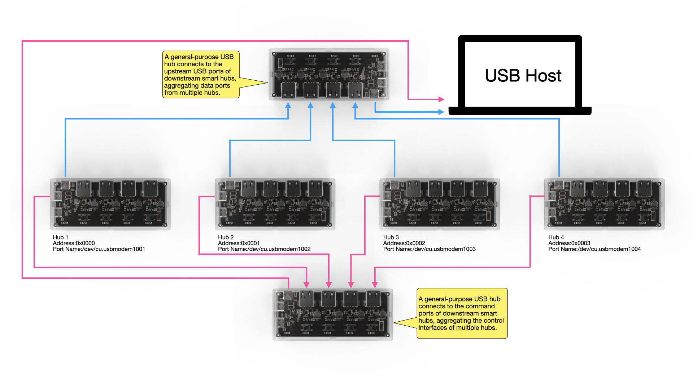
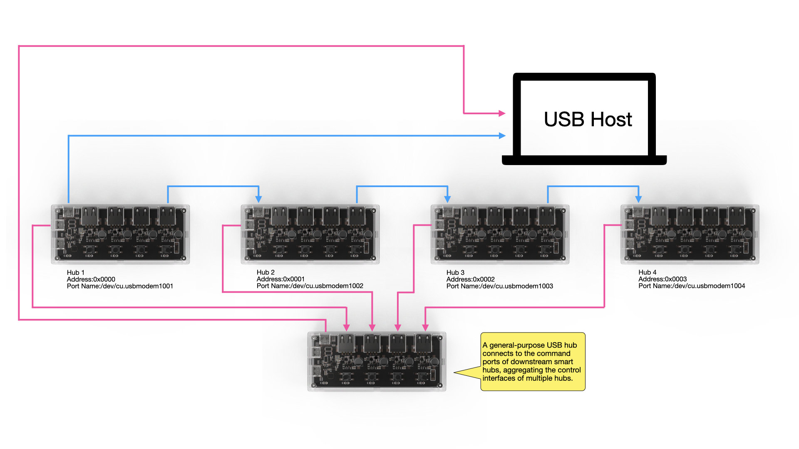

# SmartUSBHub 通信协议

## 简介

SmartUSBHub 通过 USB CDC 控制端口与主机通信。本文介绍 SmartUSBHub 系列共用的串口设置、协议帧格式、完整命令集和命令示例。不同产品的通道数和可选能力有所不同；下文的通道值和报文主要以四通道型号为例。

[English](./protocol.md) · [下载 PDF](./downloads/protocol-zh.pdf) · [产品文档](./README_cn.md) · [Python SDK](../README_cn.md)

## 文档导航

- [帧格式](#帧格式)
  - [定长协议帧：单数据字节](#定长协议帧单数据字节)
  - [定长协议帧：双数据字节](#定长协议帧双数据字节)
  - [变长协议帧：变长数据](#变长协议帧变长数据)
- [指令说明](#指令说明)
  - [通道控制](#通道控制)
  - [测量与监控](#测量与监控)
  - [告警与保护](#告警与保护)
  - [默认状态](#默认状态)
  - [设备配置](#设备配置)
  - [设备信息与发现](#设备信息与发现)
  - [附：帧校验与构造](#附帧校验与构造)
- [术语](#术语)

## 帧格式

SmartUSBHub 在同一串行链路上使用 V1、V2 和 V3 帧。下列布局中的偏移和长度均以字节为单位。

### 定长协议帧：单数据字节

| 偏移 | 字段 | 长度 | 说明 |
| ---: | --- | ---: | --- |
| 0 | SOF1 | 1 | 固定值 `0x55` |
| 1 | SOF2 | 1 | 固定值 `0x5A` |
| 2 | CMD | 1 | 命令码 |
| 3 | CHANNEL | 1 | 通道位掩码；位 0 对应通道 1 |
| 4 | VALUE | 1 | 单字节命令参数或状态 |
| 5 | SUM8 | 1 | `(CMD + CHANNEL + VALUE) & 0xFF` |

V1 帧固定为 6 字节，用于大多数设置、查询和确认消息。

### 定长协议帧：双数据字节

| 偏移 | 字段 | 长度 | 说明 |
| ---: | --- | ---: | --- |
| 0–1 | SOF | 2 | 固定值 `55 5A` |
| 2 | CMD | 1 | 命令码 |
| 3 | CHANNEL | 1 | 通道位掩码 |
| 4 | VALUE0 | 1 | 电压/电流的高字节，或 `enable` 字段 |
| 5 | VALUE1 | 1 | 电压/电流的低字节，或 `status` 字段 |
| 6 | SUM8 | 1 | `(CMD + CHANNEL + VALUE0 + VALUE1) & 0xFF` |

V2 帧固定为 7 字节，目前用于电压/电流应答，以及需要两个数据字节的电源/数据线默认状态。16 位测量值按 `VALUE0 << 8 | VALUE1` 解析。

### 变长协议帧：变长数据

| 偏移 | 字段 | 长度 | 说明 |
| ---: | --- | ---: | --- |
| 0–3 | MAGIC | 4 | 固定值 `55 AB CD EF` |
| 4 | CMD | 1 | 命令码 |
| 5 | FLAGS | 1 | `04` 请求，`02` 应答，`01` 事件 |
| 6–7 | LENGTH | 2 | 载荷长度，小端： `LEN_L, LEN_H` |
| 8–9 | CRC16 | 2 | 小端： `CRC_L, CRC_H` |
| 10–11 | REQUEST_ID | 2 | 请求 ID，小端 |
| 12 | STATUS | 1 | 通用状态码 |
| 13–15 | RESERVED | 3 | 必须为零 |
| 16… | PAYLOAD | LENGTH | 由具体命令定义的变长数据 |

固定帧头为 16 字节，载荷上限为 1024 字节，完整帧上限为 1040 字节。计算 CRC 时将第 8–9 字节置零，校验范围覆盖整个帧头和载荷。

`FLAGS` 只能取以下三个值之一：`0x04` 表示请求，`0x02` 表示应答，`0x01` 表示事件。请求使用非零的 16 位请求 ID；应答回显命令和 ID。事件的 ID 和状态均为零。由 V1 `0xF9` 查询触发的序列号正文是唯一允许 ID 为零的应答。当前保留字节必须为零。请求中的保留字段非零时，按参数无效拒绝；消息类型标志未知时绝不执行。ID 不表示设备会自动重放操作或去重；主机不能盲目重试非幂等操作。

| STATUS | SDK 常量                          | 说明        |
| ---: | --- | --- |
|      0 | `V3_STATUS_OK`                  | 成功        |
|      1 | `V3_STATUS_UNSUPPORTED_COMMAND` | 不支持的指令    |
|      2 | `V3_STATUS_UNSUPPORTED_FEATURE` | 本产品不支持该功能 |
|      3 | `V3_STATUS_INVALID_ARGUMENT`    | 参数无效      |
|      4 | `V3_STATUS_BUSY`                | 忙         |
|      5 | `V3_STATUS_NOT_READY`           | 尚未就绪      |
|      6 | `V3_STATUS_IO_ERROR`            | I/O 错误    |
|      7 | `V3_STATUS_INTERNAL_ERROR`      | 内部错误      |

#### 控制与配置失败

成功应答沿用现有帧格式和载荷。当前固件会明确报告以下失败：

| 命令 | 失败应答 |
| --- | --- |
| `0x01` 电源控制 | 因互锁、电源操作忙、保护拒绝或 GPIO 写入失败而拒绝时，返回 V1 `CHANNEL=FF, VALUE=FF` |
| `0x02` 互锁选择 | 因电源操作忙、保护拒绝或 GPIO 写入失败而拒绝时，返回 V1 `VALUE=FF` |
| `0x06` 工作模式、`0x09` 按键、`0x0F` 状态记忆、`0xFC` 恢复出厂设置 | 无法完成或保存操作时，返回 V1 `CHANNEL=FF, VALUE=FF` |
| `0x0B` 电源默认状态、`0x0D` USB2 数据默认状态 | 保存失败时，返回 V2 `CHANNEL=FF, VALUE0=FF, VALUE1=FF` |
| `0x1E` 通道名称、`0x20` 设备别名、`0x2D` USB3 数据默认状态 | 保存失败时，返回 V3 `STATUS=6`（`IO_ERROR`），载荷为空 |
| `0x11` 设备地址 | 保存失败时不返回 ACK，主机等待超时。对于地址 `0xFFFF`，`FF/FF` 仍是有效的成功回显 |

对于这些被拒绝的设置操作，SDK 返回 `False`，保留原配置缓存，不把明确拒绝当作通信超时。设置设备地址时，还要求回显地址与请求一致。旧 V1/V2 帧没有请求 ID，无法区分它与此前相同请求的延迟应答。

保存失败后，会恢复受影响的 RAM 设置，并尝试恢复原 Flash 页。Flash 反复失败，或在单页擦写过程中断电，仍可能导致持久化设置丢失。恢复出厂设置失败时，不应用默认输出状态。电源命令可能已经部分生效；控制命令被拒绝后，应先读取实际输出状态，再继续操作。

只有成功时才按命令定义解析数据；错误应答的数据可能包含该命令的诊断信息。JSON 使用 UTF-8 编码，不以 NUL 结尾，且仅在命令明确规定时使用。二进制可选字段必须通过明确的请求标志或带长度的扩展块启用，不通过启发式方法猜测数据是 JSON 还是二进制。

SDK 按 `(CMD, REQUEST_ID)` 匹配应答，忽略不匹配的应答，并注销已超时的请求。同一命令只允许有一个尚未完成的 SDK 请求。分配 ID 时跳过零、正在使用的 ID，以及最近 60 秒内用过的 ID；设备应答不得滞留超过此时间。主动事件不会满足 ACK 等待。`last_protocol_error` 提供最近一次拒绝信息；现有返回布尔值的查询/设置 API 会报告失败，但不会因明确拒绝而触发超时恢复。

不完整接收帧在 SDK 中空闲 250 ms 后失效，在当前 MCU 解析器中空闲 20 ms 后失效。这些是字节间超时，与命令应答超时（包括耗时较长的认证）不同。格式有效但命令未知时返回状态 1；CRC 错误的帧直接丢弃。CDC 会将一帧拆分为端点数据包。

## 指令说明

> [!NOTE]
>
> - 下列所有数据值均为十六进制。
> - 通道值使用 `Channel_e` 枚举，不是通道序号。控制和查询命令可通过按位或组合进行批量操作；设备处于*互锁*模式时，只能使用 `互锁控制命令 [0x02]` 控制电源，按位组合不生效。
> - 校验错误或格式错误的帧会被静默丢弃，不返回应答；未知命令返回回显帧，命令码保持原值，channel 和 value 均置为 FF。
> - 按键按下时，设备会通过 `状态上报 [0x00] 命令` 发送该通道的当前状态。
> - 随附资料包提供 UART 助手工具（uart_tool），便于快速上手。
> - 可使用 Python 控制库 [smartusbhub](https://github.com/mixedsignal-labs/smartusbhub)。
> - 本文将 USB 下游端口简称为通道。


**通道枚举值 (Channel_e):**

```c
typedef enum
{
    CH1 = 0x01,
    CH2 = 0x02,
    CH3 = 0x04,
    CH4 = 0x08,
    CH5 = 0x10,
    CH6 = 0x20,
    CH7 = 0x40,
}Channel_e;

```
可用通道取决于产品型号：四通道产品使用 CH1 到 CH4，七通道产品使用 CH1 到 CH7。

> [!NOTE]
>
> **设备通信参数:**
>
> - 波特率: 115200 – 921600 (默认： `115200`)
>
> - 数据位: `8`
>
> - 校验位: `None`
>
> - 停止位: `1`
>
> **设备名称:**
>
> - Windows: `COMx`
>
> - Linux: `/dev/ttyACMx`
>
> - macOS: `/dev/cu.usbmodemx`


------

### 通道控制


| 指令               | 指令码  | 说明                   |
| :--- | :--- | :--- |
| 控制通道电源开关         | 0x01 | 控制指定通道的 VBUS 供电状态    |
| 查询通道电源状态         | 0x00 | 查询通道当前 VBUS 供电是否开启   |
| 控制互锁模式下电源开关      | 0x02 | 通道互锁下，仅允许一路通道电源开启    |
| 控制 USB2.0 数据开关   | 0x05 | 控制通道 USB2.0 数据是否连通   |
| 查询 USB2.0 数据开关状态 | 0x08 | 查询通道 USB2.0 数据当前开关状态 |
| 控制 USB3.0 数据开关   | 0x15 | 控制通道 USB3.0 数据是否连通   |
| 查询 USB3.0 数据开关状态 | 0x16 | 查询通道 USB3.0 数据当前开关状态 |
| 设置上行主机选择         | 0x22 | 设置上行主机               |
| 获取上行主机选择         | 0x23 | 读取当前上行主机选择           |
| 查询全部通道电源状态 | 0x36 | 一帧返回整机电源状态位掩码 |
| 查询全部通道 USB2 数据状态 | 0x37 | 一帧返回整机 USB2 数据状态位掩码 |
| 查询全部通道 USB3 数据状态 | 0x38 | 一帧返回整机 USB3 数据状态位掩码 |

#### **控制通道电源开关 (CMD: 0x01)**

> [!NOTE]
>
> 设备处于互锁模式时，普通电源控制命令（CMD: 0x01）不生效，必须使用互锁控制命令（CMD: 0x02）。
>
> 在互锁模式下发送普通电源控制命令，会返回“无效命令”帧：
>
> *无效命令:*
>
> ```
> 55 5A 01 FF FF FF
> ```

##### **数据字段说明:**

| data[0]     | data[1]             |
| --- | --- |
| 通道标识  | 通道电源状态 |
| `Channel_e` | 0（关闭），1（开启）     |


##### **开启通道 1 的电源**

**命令**:

```
55 5A 01 01 01 03
```

**应答**:

```
55 5A 01 01 01 03
```

##### **关闭通道 1 的电源**

**命令**:

```
55 5A 01 01 00 02
```

**应答**:

```
55 5A 01 01 00 02
```


##### **开启通道 2 的电源**

**命令**:

```
55 5A 01 02 01 04
```

**应答**:

```
55 5A 01 02 01 04
```

##### **关闭通道 2 的电源**

**命令**:

```
55 5A 01 02 00 03
```

**应答**:

```
55 5A 01 02 00 03
```


##### **开启通道 3 的电源**

**命令**:

```
55 5A 01 04 01 06
```

**应答**:

```
55 5A 01 04 01 06
```

##### **关闭通道 3 的电源**

**命令**:

```
55 5A 01 04 00 05
```

**应答**:

```
55 5A 01 04 00 05
```


##### **开启通道 4 的电源**

**命令**:

```
55 5A 01 08 01 0A
```

**应答**:

```
55 5A 01 08 01 0A
```

##### **关闭通道 4 的电源**

**命令**:

```
55 5A 01 08 00 09
```

**应答**:

```
55 5A 01 08 00 09
```


##### **组合控制示例**

##### **开启通道 1 和通道 3 的电源**

**命令**:

```
55 5A 01 05 01 07
```

**应答**:

```
55 5A 01 05 01 07
```

##### **关闭通道 1 和通道 3 的电源**

**命令**:

```
55 5A 01 05 00 06
```

**应答**:

```
55 5A 01 05 00 06
```

##### **开启所有通道**

**命令**:

```
55 5A 01 0F 01 11
```

**应答**:

```
55 5A 01 0F 01 11
```

##### **关闭所有通道**

**命令**:

```
55 5A 01 0F 00 10
```

**应答**:

```
55 5A 01 0F 00 10
```

##### 多通道上电间隔

`device.power_on_stagger_ms` 若存在，表示多通道 ON 命令中由固件控制的相邻选中通道上电间隔（USB3 四口为 1 ms）。单通道命令和 OFF 命令不增加该延迟。这是只读产品配置，不提供 App 设置，也不需要主机额外延时。

#### **查询通道电源状态 (CMD: 0x00)**

##### **数据字段说明:**

| data[0]     | data[1]             |
| --- | --- |
| 通道标识  | 通道电源状态 |
| `Channel_e` | 0（关闭），1（开启）     |


##### **查询通道 1 的电源状态**

**命令**:

```
55 5A 00 01 00 01
```

**应答**:

**若通道 1 的电源关闭**:

```
55 5A 00 01 00 01
```

**若通道 1 的电源开启**:

```
55 5A 00 01 01 02
```


##### **查询通道 2 的电源状态**

**命令**:

```
55 5A 00 02 00 02
```

**应答**:

**若通道 2 的电源关闭**:

```
55 5A 00 02 00 02
```

**若通道 2 的电源开启**:

```
55 5A 00 02 01 03
```


##### **查询通道 3 的电源状态**

**命令**:

```
55 5A 00 04 00 04
```

**应答**:

**若通道 3 的电源关闭**:

```
55 5A 00 04 00 04
```

**若通道 3 的电源开启**:

```
55 5A 00 04 01 05
```


##### **查询通道 4 的电源状态**

**命令**:

```
55 5A 00 08 00 08
```

**应答**:

**若通道 4 的电源关闭**:

```
55 5A 00 08 00 08
```

**若通道 4 的电源开启**:

```
55 5A 00 08 01 09
```


##### **组合控制示例**:

##### **查询所有通道的电源状态**

**命令**:

```
55 5A 00 0F 00 0F
```

**应答**:

```
55 5A 00 01 01 02
55 5A 00 02 00 02
55 5A 00 04 00 04
55 5A 00 08 01 09
```

- **通道 1 电源：开启**

- **通道 2 电源：关闭**

- **通道 3 电源：关闭**

- **通道 4 电源：开启**

#### 控制通道 USB2.0 数据开关（CMD: 0x05）

设备可控制指定通道的 D+ 和 D− 差分线对是否连通，从而实现保留供电但断开数据连接等用途。

> [!NOTE]
>
> - 默认情况下，各通道的 USB 数据线（D+/D−）保持连通，除非用户发送控制命令（CMD: 0x05）手动断开。
>
> - 启用断电状态记忆后，会记住数据线的通断状态。

##### **数据字段说明:**

| data[0]     | data[1]                 |
| --- | --- |
| 通道标识  | 通道数据线状态 |
| `Channel_e` | 0（关闭），1（开启）         |


##### **连通通道 1 的数据线**

**命令**:

```
55 5A 05 01 01 07
```

**应答**:

```
55 5A 05 01 01 07
```

##### **断开通道 1 的数据线**

**命令**:

```
55 5A 05 01 00 06
```

**应答**:

```
55 5A 05 01 00 06
```


##### **连通通道 2 的数据线**

**命令**:

```
55 5A 05 02 01 08
```

**应答**:

```
55 5A 05 02 01 08
```

##### **断开通道 2 的数据线**

**命令**:

```
55 5A 05 02 00 07
```

**应答**:

```
55 5A 05 02 00 07
```


##### **连通通道 3 的数据线**

**命令**:

```
55 5A 05 04 01 0A
```

**应答**:

```
55 5A 05 04 01 0A
```

##### **断开通道 3 的数据线**

**命令**:

```
55 5A 05 04 00 09
```

**应答**:

```
55 5A 05 04 00 09
```


##### **连通通道 4 的数据线**

**命令**:

```
55 5A 05 08 01 0E
```

**应答**:

```
55 5A 05 08 01 0E
```

##### **断开通道 4 的数据线**

**命令**:

```
55 5A 05 08 00 0D
```

**应答**:

```
55 5A 05 08 00 0D
```


##### **组合控制示例**:

##### **连通所有通道的数据线**

**命令**:

```
55 5A 05 0F 01 15
```

**应答**:

```
55 5A 05 0F 01 15
```

##### **断开所有通道的数据线**

**命令**:

```
55 5A 05 0F 00 14
```

**应答**:

```
55 5A 05 0F 00 14
```

#### 查询通道 USB2.0 数据开关状态（CMD: 0x08）

##### **数据字段说明:**

| data[0]     | data[1]                 |
| --- | --- |
| 通道标识  | 通道数据线状态 |
| `Channel_e` | 0（关闭），1（开启）         |


##### **查询通道 1 的数据线状态**

**命令**:

```
55 5A 08 01 00 09
```

**应答**:

**若通道 1 的数据线断开**:

```
55 5A 08 01 00 09
```

**若通道 1 的数据线连通**:

```
55 5A 08 01 01 0A
```


##### **查询通道 2 的数据线状态**

**命令**:

```
55 5A 08 02 00 0A
```

**应答**:

**若通道 2 的数据线断开**:

```
55 5A 08 02 00 0A
```

**若通道 2 的数据线连通**:

```
55 5A 08 02 01 0B
```


##### **查询通道 3 的数据线状态**

**命令**:

```
55 5A 08 04 00 0C
```

**应答**:

**若通道 3 的数据线断开**:

```
55 5A 08 04 00 0C
```

**若通道 3 的数据线连通**:

```
55 5A 08 04 01 0D
```


##### **查询通道 4 的数据线状态**

**命令**:

```
55 5A 08 08 00 10
```

**应答**:

**若通道 4 的数据线断开**:

```
55 5A 08 08 00 10
```

**若通道 4 的数据线连通**:

```
55 5A 08 08 01 11
```


##### **组合控制示例**:

##### **组合控制示例：查询所有通道的数据线状态**

**命令**:

```
55 5A 08 0F 00 17
```

**应答**:

```
55 5A 08 01 01 0A
55 5A 08 02 01 0B
55 5A 08 04 01 0D
55 5A 08 08 01 11
```

- **通道 1 数据：连通**

- **通道 2 数据：连通**
- **通道 3 数据：连通**
- **通道 4 数据：连通**

#### **控制通道 USB3.0 数据开关(CMD:0x15)**


通道值与其他控制指令一致，支持按位组合（CH1=01、CH2=02、CH3=04、CH4=08）。


##### **data域描述：**


| data[0] | data[1]       |
| --- | --- |
| 通道位掩码   | 01=连通 / 00=断开 |


**连通通道1 USB3.0 数据**：


```
55 5A 15 01 01 17
```


**返回**：


```
55 5A 15 01 01 17
```


**断开通道1 USB3.0 数据**：


```
55 5A 15 01 00 16
```


**返回**：


```
55 5A 15 01 00 16
```


**连通所有通道 USB3.0 数据**：


```
55 5A 15 0F 01 25
```


**返回**：


```
55 5A 15 0F 01 25
```

#### **查询通道 USB3.0 数据开关状态(CMD:0x16)**


##### **data域描述：**


| data[0] | data[1] |
| --- | --- |
| 通道位掩码   | 00（查询）  |


**查询通道1 USB3.0 数据的开关状态**：


```
55 5A 16 01 00 17
```


**返回**（01=连通）：


```
55 5A 16 01 01 18
```


**查询所有通道的 USB3.0 数据开关状态**（批量查询推荐使用聚合查询 CMD: 0x38）：


```
55 5A 16 0F 00 25
```


**返回**（每通道一帧，按通道升序）：


```
55 5A 16 01 01 18
55 5A 16 02 01 19
55 5A 16 04 01 1B
55 5A 16 08 01 1F
```

#### 全通道开关状态聚合查询（CMD: 0x36 / 0x37 / 0x38）

协议 API 1.3.0 新增三条 6 字节 V1 查询命令。每条应答包含所有通道对应开关的状态。

| 命令 | 命令码 | 位为 1 的含义 |
| --- | --- | --- |
| 获取通道电源位掩码 | `0x36` | 电源开关开启 |
| 获取通道 USB2 数据位掩码 | `0x37` | USB2 数据开关连通 |
| 获取通道 USB3 数据位掩码 | `0x38` | USB3 数据开关连通 |

应缓存 `0x2B` 摘要，并且仅在 `channel_status_mask` 明确为 `true` 时使用这些命令。USB2/USB3 查询还分别要求支持 `usb2_data_switch` / `usb3_data_switch`。设备没有能力声明或缺少该字段时，沿用逐通道的 `0x00` / `0x08` / `0x16` 查询。

| 偏移 | 请求 | 应答 |
| --- | --- | --- |
| 0–1 | `55 5A` | `55 5A` |
| 2 | 命令 | 回显的命令 |
| 3, channel | `00` | 位掩码的低 8 位 |
| 4, data | `00` | 位掩码的高 8 位 |
| 5 | `(cmd + channel + data) & 0xFF` | 相同的校验算法 |

位掩码按 `channel | (data << 8)` 解码。位 0 表示通道 1，位 9 表示通道 10，最多可表示 16 个通道。实际通道数从能力声明或最大通道数查询获取，超出实际通道数的位必须为零。每次请求返回所有通道，SDK 再筛选所需通道。

电源状态查询为 `55 5A 36 00 00 36`。若通道 1、3、9 已开启，位掩码为 `0x0105`，应答为 `55 5A 36 05 01 3C`。

返回值是 GPIO 开关逻辑的回读状态。端口电压/电流由测量 API 提供，USB 枚举状态由主机提供。每条命令在一个短临界区内读取所有通道。三条命令各有独立的采集时刻；完整读取三种状态需要三帧，共 18 字节。默认配置继续使用原有 API。

参数无效或能力不支持时，返回 `channel=data=FF` 的 V1 拒绝应答。GPIO 读取失败时放弃整条应答，主机报告超时。对于 16 通道设备，`FFFF` 也可以是所有通道均开启的有效位掩码，因此调用方必须先验证能力，并始终发送规定的零参数。

`get_channel_power_status()`、`get_channel_usb2_dataline_status()` 和 `get_channel_usb3_dataline_status()` 会自动选择通信方式。不指定通道时查询所有通道。单通道电源查询返回整数，多通道电源查询和 USB 数据状态查询返回字典。聚合应答会更新完整的通道缓存，并调用现有的逐通道状态回调；回调中的通道参数仍为通道位掩码。聚合查询超时或应答无效时返回 `None`。

旧协议查询及默认电源/默认 USB2 查询会清除所请求通道的过期缓存项，并等待全部应答或超时。保留原有的部分结果行为：只返回本次查询中实际收到的通道，并记录缺失通道；没有收到任何通道时返回 `None`。调用方应检查返回字典的键是否覆盖所请求的通道。旧协议的通道字段只能寻址通道 1 到 8，更高通道的状态查询要求支持聚合查询。

新固件继续支持原有的逐通道命令，兼容旧 SDK 和脚本。新 SDK 与旧固件配合时使用兼容路径；升级到支持聚合查询的固件后再启用聚合查询。

#### **控制互锁模式下的电源 (CMD: 0x02)**

> [!IMPORTANT]
> 在互锁模式下，只能用此命令选择供电通道；普通电源命令（CMD: 0x01）不能控制通道。关闭通道电源时也会断开其数据线。CMD: 0x02 本身只控制电源；如果还需控制选中通道的 USB2 数据线，请使用数据线命令（CMD: 0x05）。
>
> 互锁命令会开启位掩码中编号最小的通道，并关闭其他所有通道；位掩码为 0 时关闭所有通道。data[1] 不影响开关动作，只原样回显。

**控制真值表:**

| **通道 1** | **通道 2** | **通道 3** | **通道 4** |
| --- | --- | --- | --- |
| 关闭        | 关闭        | 关闭        | 关闭        |
| **开启**      | 关闭        | 关闭        | 关闭        |
| 关闭        | **开启**      | 关闭        | 关闭        |
| 关闭        | 关闭        | **开启**      | 关闭        |
| 关闭        | 关闭        | 关闭        | **开启**      |

##### **数据字段说明:**

| data[0]     | data[1]             |
| --- | --- |
| 通道标识  | 通道电源状态 |
| `Channel_e` | 0（关闭），1（开启）     |


##### **开启通道 1 的电源（其他通道关闭）**

**命令**:

```
55 5A 02 01 01 04
```

**应答**:

```
55 5A 02 01 01 04
```


##### **开启通道 2 的电源（其他通道关闭）**

**命令**:

```
55 5A 02 02 01 05
```

**应答**:

```
55 5A 02 02 01 05
```


##### **开启通道 3 的电源（其他通道关闭）**

**命令**:

```
55 5A 02 04 01 07
```

**应答**:

```
55 5A 02 04 01 07
```


##### **开启通道 4 的电源（其他通道关闭）**

**命令**:

```
55 5A 02 08 01 0B
```

**应答**:

```
55 5A 02 08 01 0B
```


##### **关闭所有通道**

位掩码为 0 时关闭所有通道：

**命令**:

```
55 5A 02 00 00 02
```

**应答**:

```
55 5A 02 00 00 02
```

#### 设置和获取上行主机选择（CMD: 0x22 / 0x23）

固件 1.0.0，产品类型=0x04：V1 SET=0x22，GET=0x23；channel=0。
SET 的 data：1=Host1，2=Host2。GET 请求的 data=0。
成功应答：channel=0，data=实际选择值。失败应答：FF/FF。
当前固件只接受 Host1/Host2，并将选择结果保存到 App Flash。旧固件接受 0（断开），且不保存选择。参数未设置或恢复出厂设置后选择 Host1。
USB3 端口数据控制使用 0x15/0x16 和端口位掩码。

[中文 SDK 接入说明](products/usb3_4p/sdk_cn.md)

### 测量与监控


| 指令       | 指令码  | 说明                    |
| :--- | :--- | :--- |
| 查询电压采样   | 0x03 | 查询通道 VBUS 电压值（单位：mV）  |
| 查询电流采样   | 0x04 | 查询通道 VBUS 电流值（单位：mA）  |
| 批量测量与测量流 | 0x1A | 批量读取通道电压、电流和功率，或启用、关闭测量数据流 |
| 查询系统温度   | 0x25 | 查询系统温度（0.01℃）         |
| 批量采集记录 | 0x28 | 支持型号的测量数据流批次，包含功率记录 |
| 测量滤波 | 0x29 | 支持型号的瞬时值 / 8 点平均设置 |

#### **查询通道电压 (CMD: 0x03)**


> [!NOTE]
>
> - 设备可测量各通道的输出电压（VBUS），用于检查总线是否正常工作。
> - 电压单位为 mV（毫伏）。
> - 电压分辨率为 1 mV。

##### **数据字段说明:**

| data[0]     | data[1]                     | data[2]                    |
| --- | --- | --- |
| 通道标识  | 通道电压值[15:8] | 通道电压值[7:0] |
| `Channel_e` | -                           | -                          |


##### **查询通道 1 的电压**:

**命令**:

```
55 5A 03 01 00 04
```

**应答**:

```
55 5A 03 01 13 56 6D
```

**通道 1 电压 = 0x1356 = 4950 mV （通道开启）**


##### **查询通道 2 的电压**:

**命令**:

```
55 5A 03 02 00 05
```

**应答**:

```
55 5A 03 02 00 0C 11
```

**通道 2 电压 = 0x000C = 12 mV （通道关闭）**


##### **查询通道 3 的电压**:

**命令**:

```
55 5A 03 04 00 07
```

**应答**:

```
55 5A 03 04 00 09 10
```

**通道 3 电压 = 0x0009 = 9 mV （通道关闭）**


##### **查询通道 4 的电压**:

**命令**:

```
55 5A 03 08 00 0B
```

**应答**:

```
55 5A 03 08 00 08 13
```

**通道 4 电压 = 0x0008 = 8 mV （通道关闭）**

#### **查询通道电流 (CMD: 0x04)**

> [!NOTE]
>
> - 设备可测量各通道电流，用于判断设备运行状态。
> - 电流单位为 mA（毫安）。
> - 电流分辨率为 1 mA。

##### **数据字段说明:**

| data[0]     | data[1]                      | data[2]                     |
| --- | --- | --- |
| 通道标识  | 通道电流值 [15:8] | 通道电流值 [7:0] |
| `Channel_e` | -                            | -                           |


##### **查询通道 1 的电流**:

**命令**:

```
55 5A 04 01 00 05
```

**应答**:

```
55 5A 04 01 01 29 2F
```

**通道 1 电流 = 0x0129 = 297 mA**


##### **查询通道 2 的电流**:

**命令**:

```
55 5A 04 02 00 06
```

**应答**:

```
55 5A 04 02 00 00 06
```

**通道 2 电流 = 0x0000 = 0 mA**


##### **查询通道 3 的电流**:

**命令**:

```
55 5A 04 04 00 08
```

**应答**:

```
55 5A 04 04 00 00 08
```

**通道 3 电流 = 0x0000 = 0 mA**


##### **查询通道 4 的电流**:

**命令**:

```
55 5A 04 08 00 0C
```

**应答**:

```
55 5A 04 08 00 00 0C
```

**通道 4 电流 = 0x0000  = 0ma**

#### 批量测量与测量数据流（CMD: 0x1A）

请求载荷固定为两个字节：

| 偏移 | 字段 | 说明 |
| ---: | --- | --- |
| 0 | `channel_mask` | 通道位掩码；位 0 对应通道 1 |
| 1 | `request_flags` | `0x01` 强制立即采样；`0x02` 启用数据流；`0x04` 禁用数据流；可按需组合各位 |

应答载荷长度为 `8 + 8 × 返回通道数`：

| 偏移 | 字段 | 说明 |
| ---: | --- | --- |
| 0 | `channel_mask` | 本帧实际包含的通道 |
| 1 | `fresh_mask` | 对应位为 1 表示该通道的样本仍处于有效时限内 |
| 2 | `valid_mask` | 对应位为 1 表示该通道的测量值有效 |
| 3 | `sample_period_ms` | 设备采样周期；当前固件通常报告 10 ms |
| 4–7 | `sample_tick` | 32 位设备打包时刻计数，小端序；以 RTOS tick 为单位，不是 ADC 采样时刻 |
| 8… | `measurements` | 按通道号升序排列；每通道为 `voltage_u16_le, current_u16_le, power_u32_le`，单位分别为 mV、mA 和 µW |

启用数据流后，设备先返回 `FLAGS=0x02` 的普通应答，再周期性主动发送 `0x1A` 帧，标志为 `FLAGS=0x01`。当前默认数据流发送间隔为 10 ms（约 100 Hz）。`sample_period_ms` 表示采样周期，发送间隔由固件配置控制。

查询通道 1 和 2：

```text
55 AB CD EF 1A 04 02 00 58 E7 01 00 00 00 00 00 03 00
```

应答示例：通道 1 为 5000 mV、300 mA 和 1500000 µW；通道 2 为 0 mV、0 mA 和 0 µW：

```text
55 AB CD EF 1A 02 18 00 B7 7D 01 00 00 00 00 00 03 03 03 0A 01 00 00 00 88 13 2C 01 60 E3 16 00 00 00 00 00 00 00 00 00
```

启用通道 1 和 2 的测量数据流：

```text
55 AB CD EF 1A 04 02 00 59 C9 01 00 00 00 00 00 03 02
```

同一组示例数据对应的主动数据流帧如下。其帧头中 `FLAGS=0x01`，因此 CRC 与普通应答不同：

```text
55 AB CD EF 1A 01 18 00 2C 78 00 00 00 00 00 00 03 03 03 0A 01 00 00 00 88 13 2C 01 60 E3 16 00 00 00 00 00 00 00 00 00
```

禁用通道 1 和 2 的测量数据流：

```text
55 AB CD EF 1A 04 02 00 5A BB 01 00 00 00 00 00 03 04
```

##### 功率与批量采集记录

`GET_CHANNEL_MEASUREMENTS (0x1A)` 查询和数据流上报保留 8 字节头。
每个选中通道按通道号升序输出 `u16 mV, u16 mA, u32 power_uW`（小端序），每通道 8 字节。
SDK 中的功率以 mW 表示。hardware-monitor 来源返回同一锁存快照中的瞬时硬件功率，其他产品根据电压和电流计算功率。
`0x28` 现有批量格式的每条记录直接扩展为 48 字节：在原有 32 字节之后追加四路 `u32 power_uW`。
此格式不兼容旧测量记录，固件、SDK 和 App 必须同步升级。PAC 功率不随 V/I 的 8 点平均设置切换。

#### 测量滤波（CMD: 0x29）

USB3 四口固件启动时使用 PAC1944 硬件 8 点平均。`measurement` 详情声明 `default_filter: "avg8"`（不带 PAC 的 BASIC 为 null）。Studio Pro 不提供滤波设置。原有 SDK 0x29 接口保持兼容；临时修改的设置在重启后恢复为 avg8。

#### 系统温度查询（CMD: 0x25）

空载荷 `0x25` 单独请求板载温度：状态 0 后跟小端有符号 int16，单位为 0.01 °C；状态 1 表示不支持，2 表示暂不可用。USB3 RevB 对 PC0/ADC10 取 16 次采样平均，并按 B=3380 K 换算 33 kΩ/10 kΩ NTC 分压器的温度。ADC 输入无效时返回 2。成品板尚未做温度校准。旧固件可能不应答，不得因此触发恢复或重启。

### 告警与保护


| 指令     | 指令码  | 说明                            |
| :--- | :--- | :--- |
| 告警规则配置 | 0x30 | 查询/设置测量硬件阈值告警（OC/UC/OV/UV/OP） |
| 查询告警状态 | 0x31 | 读取告警 active/history/trip 缓存状态 |
| 清除告警历史 | 0x32 | 按通道掩码清除告警历史（不解除断电锁定）          |
| 告警事件订阅 | 0x33 | 开启/关闭告警事件推送（事件经 0x34 上报）      |
| 告警事件上报 | 0x34 | 设备主动上报发生告警的通道、告警类型与动作         |
| 解除断电锁定 | 0x35 | 清除保护锁定                        |

#### 测量单元告警与保护（CMD: 0x30–0x35）

HBP_USB3_4CH 单独声明 `alerts` 能力，包含 supported/controllable、channel_mask=15、types=[oc,uc,ov,uv,op]、samples=[1,4,8,16] 和 actions=[notify,power_off_lock]。原有 `overcurrent` 能力继续描述旧硬件 FLAG 查询。PA5 上的 ALERT1 仍用于指示转换就绪，PA4 上的 ALERT2 用于唤醒告警监测任务。Control Pannel 没有告警配置界面；Studio Pro 将配置直接放在各通道卡片中。

下文所有整数均为小端序，通道从 1 开始编号。类型 ID 0..4 依次为过流、欠流、过压、欠压和过功率，单位分别为 mA/mA/mV/mV/mW。USB3 四口固件 1.0.0 默认启用过流告警：阈值 4000 mA、连续 1 次采样、仅通知。其他类型默认禁用。自定义阈值、启用标志、采样次数和动作保存在 App Flash 参数页（0xF700）。只有测量硬件和 Flash 回读验证都通过才视为设置成功；参数相同则不擦写 Flash。启动时先恢复保护，再开启电源。恢复出厂设置会恢复默认规则。历史、保护锁定及订阅不持久化。动作 0 仅通知；动作 1 关闭 VBUS/数据连接，并锁定所有上电路径，直到显式复位或重启。

| 命令 | 请求 | 成功应答 |
| --- | --- | --- |
| 0x30 ALERT_CONFIG | 查询 `[ch,type]`；设置 `[ch,type,enabled,samples,action,0,threshold:u32]` | 设置布局后附 `raw_threshold:u32`，共 14 字节 |
| 0x31 GET_ALERT_STATUS | 空载荷 | 32 字节缓存状态，见下文 |
| 0x32 CLEAR_ALERT_LATCH | `[channel_mask]` | 回显；只清除历史 |
| 0x33 ALERT_EVENT_SUBSCRIPTION | `[0/1]` | 回显；订阅状态变化时清空待发送事件 |
| 0x34 ALERT_EVENT | 主动 EVENT，请求 ID 为 0 | `[sequence:u32,tick_ms:u32,ch,causes,action,power]` |
| 0x35 RESET_PROTECTION_TRIP | `[channel_mask]` | 回显；解除锁定但不上电 |

状态格式为 `[schema=1,ready,io_fault,subscribed,sequence:u32,tick_ms:u32,dropped_events:u32]`，随后按逻辑通道顺序排列四条 `[active,history,trip,power]` 记录。原因位 0..4 与类型 ID 对应，位 5 表示监测 I/O 失败。active 表示最近硬件锁存窗口中观察到的告警，不是比较器的瞬时电平。查询不会直接读取或清除芯片状态。复位要求选中的端口已关闭、没有当前告警原因，并且 30 ms 内有正常的监测读数。BUSY 表示不满足复位条件；NOT_READY 表示监测不可用或已过期；IO_ERROR 表示配置失败。

阈值范围：0<=I<5000、0<=V<9000、0<=P<45000。这些是比较器的换算范围，不是端口的安全额定值。比较器步长为 5000/32768 mA、9000/32768 mV 和 45000/8388608 mW。整数请求向下取整；应答同时包含请求阈值和经验证的原始寄存器值。更新阈值/连续采样次数期间，先禁用受影响的比较器，清除过期状态，再重新启用。REFRESH_V 保留累加器。其他通道和转换告警保持启用。配置失败时回滚；回滚失败则锁定所有端口，直到重启。监测 I/O 中断时，锁定启用了保护规则的端口。

端口关闭期间及上电后的 100 ms 内屏蔽 UC/UV。专用任务读取“读取即清除”的状态，既由 ALERT2 边沿触发，也以约 10 ms 的周期兜底轮询。延迟还包括连续采样确认、任务调度和共享总线占用；此功能不能替代硬件短路保护。断电后比较器告警消失，并不能证明负载故障已经排除。解除锁定后显式上电属于重试，仍可能再次触发保护。

事件使用单调递增且会回绕的序列号，队列最多保存 8 条记录；溢出时丢弃最早的记录，并递增 dropped_events。事件不会完成 ACK 等待。SDK 方法包括 get_alert_config、set_alert_config、get_alert_status、clear_alert_latch、reset_protection_trip 和 subscribe_alert_events。注册 CMD_ALERT_EVENT 可接收已解析的事件字典。回调在接收线程中执行，不要在回调中等待串口命令。SDK 类型字符串为 overcurrent/undercurrent/overvoltage/undervoltage/overpower，动作为 notify/power_off_lock。

##### 出厂默认规则查询

USB3 固件 1.0.0：0x30 查询 `[ch,type,0]` 用于读取 MCU 出厂默认规则，应答仍为 14 字节；不写寄存器或 Flash。SDK `get_alert_defaults` 使用此接口。Studio Pro 恢复默认值时先查询，再写入并回读确认；查询失败则不修改配置，也不使用主机中硬编码的默认值兜底。

##### 保护重试与自动清除历史

连续 2 秒没有当前告警且监测正常后，自动清除 history；trip 仍保留，不自动上电。显式上电请求可在以下条件全部满足时清除 trip 并重试：30 ms 内的监测读数未过期、没有 I/O/配置故障、没有当前告警，且端口已关闭。自动恢复路径不会清除 trip。SDK `set_channel_power(..., state=1)` 会先对选中的已锁定通道发送 0x35；若复位被拒绝，则不继续发送上电命令。旧告警固件也使用此握手流程。0x32 和 0x35 继续保留，以兼容脚本。

### 默认状态


| 指令               | 指令码  | 说明                      |
| :--- | :--- | :--- |
| 设置电源默认状态         | 0x0B | 配置上电后 VBUS 默认开启/关闭      |
| 查询电源默认状态         | 0x0C | 查询通道电源默认状态              |
| 设置 USB2.0 数据默认状态 | 0x0D | 配置 USB2.0 数据默认开关状态      |
| 查询 USB2.0 数据默认状态 | 0x0E | 查询 USB2.0 数据默认状态        |
| 设置断电状态记忆         | 0x0F | 开启/关闭通道状态记忆             |
| 查询断电状态记忆设置 | 0x10 | 查询是否启用断电状态记忆功能 |
| 设置 USB3.0 默认数据状态 | 0x2D | 配置启动恢复的 USB3.0 数据默认开关状态 |
| 查询 USB3.0 默认数据状态 | 0x2E | 读取 USB3.0 数据默认开关状态      |
| 查询全部电源默认配置 | 0x39 | 每通道两位的电源默认配置 |
| 查询全部 USB2 默认配置 | 0x3A | 每通道两位的 USB2 默认配置 |
| 查询全部 USB3 默认配置 | 0x3B | 每通道两位的 USB3 默认配置 |

#### **设置通道电源默认状态 (CMD: 0x0B)**

> [!NOTE]
>
> - 决定上电后的通道状态时，默认状态优先于断电状态记忆。若启用默认状态，即使同时启用断电状态记忆，上电后仍按默认状态决定各通道的电源或数据通断状态。
> - 禁用默认状态时，上电后的通道状态由断电状态记忆设置决定。若断电状态记忆也被禁用（出厂配置），上电后所有通道默认为关闭。
> - 出厂默认配置：所有通道的电源输出均为 `OFF`。

##### **数据字段说明:**

| data[0]     | data[1]                    | data[2]             |
| --- | --- | --- |
| 通道标识  | 启用电源默认状态 | 电源默认值 |
| `Channel_e` | 0（禁用），1（启用）        | 0（关闭），1（开启）     |


##### **设置通道 1 的电源默认为开启**

**命令**:

```
55 5A 0B 01 01 01 0E
```

**应答**:

```
55 5A 0B 01 01 01 0E
```


##### **设置通道 1 的电源默认为关闭**

**命令**:

```
55 5A 0B 01 01 00 0D
```

**应答**:

```
55 5A 0B 01 01 00 0D
```


##### **设置通道 2 的电源默认为开启**


**命令**:

```
55 5A 0B 02 01 01 0F
```

**应答**:

```
55 5A 0B 02 01 01 0F
```


##### **设置通道 2 的电源默认为关闭**


**命令**:

```
55 5A 0B 02 01 00 0E
```

**应答**:

```
55 5A 0B 02 01 00 0E
```


##### **设置通道 3 的电源默认为开启**


**命令**:

```
55 5A 0B 04 01 01 11
```

**应答**:

```
55 5A 0B 04 01 01 11
```


##### **设置通道 3 的电源默认为关闭**


**命令**:

```
55 5A 0B 04 00 00 0F
```

**应答**:

```
55 5A 0B 04 00 00 0F
```


##### **设置通道 4 的电源默认为开启**


**命令**:

```
55 5A 0B 08 01 01 15
```

**应答**:

```
55 5A 0B 08 01 01 15
```


##### **设置通道 4 的电源默认为关闭**


**命令**:

```
55 5A 0B 08 01 00 14
```

**应答**:

```
55 5A 0B 08 01 00 14
```


##### **设置所有通道电源默认为开启**

**命令**:

```
55 5A 0B 0F 01 01 1C
```

**应答**:

```
55 5A 0B 0F 01 01 1C
```


##### **设置所有通道电源默认为关闭**


**命令**:

```
55 5A 0B 0F 01 00 1B
```

**应答**:

```
55 5A 0B 0F 01 00 1B
```


##### **禁用通道 1 的电源默认状态**

**命令**:

```
55 5A 0B 01 00 00 0C
```

**应答**:

```
55 5A 0B 01 00 00 0C
```


##### **禁用通道 2 的电源默认状态**


**命令**:

```
55 5A 0B 02 00 00 0D
```

**应答**:

```
55 5A 0B 02 00 00 0D
```


##### **禁用通道 3 的电源默认状态**


**命令**:

```
55 5A 0B 04 00 00 0F
```

**应答**:

```
55 5A 0B 04 00 00 0F
```


##### **禁用通道 4 的电源默认状态**


**命令**:

```
55 5A 0B 08 00 00 13
```

**应答**:

```
55 5A 0B 08 00 00 13
```


##### **禁用所有通道的电源默认状态**


**命令**:

```
55 5A 0B 0F 00 00 1A
```

**应答**:

```
55 5A 0B 0F 00 00 1A
```

#### **查询通道电源默认状态 (CMD: 0x0C)**

##### **数据字段说明:**

| data[0]     | data[1]                    | data[2]             |
| --- | --- | --- |
| 通道标识  | 启用电源默认状态 | 电源默认值 |
| `Channel_e` | 0（禁用），1（启用）        | 0（关闭），1（开启）     |


##### **查询通道 1 的电源默认状态**

**命令**:

```
55 5A 0C 01 00 00 0D
```

**应答**:

**默认状态已禁用:**

```
55 5A 0C 01 00 00 0D
```

**默认关闭:**

```
55 5A 0C 01 01 00 0E
```
**默认开启:**

```
55 5A 0C 01 01 01 0F
```


##### **查询通道 2 的电源默认状态**

**命令**:

```
55 5A 0C 02 00 00 0E
```

**应答**:

**默认状态已禁用:**

```
55 5A 0C 02 00 00 0E
```

**默认关闭:**

```
55 5A 0C 02 01 00 0F
```
**默认开启:**

```
55 5A 0C 02 01 01 10
```


##### **查询通道 3 的电源默认状态**

**命令**:

```
55 5A 0C 04 00 00 10
```

**应答**:

**默认状态已禁用:**

```
55 5A 0C 04 00 00 10
```

**默认关闭:**

```
55 5A 0C 04 01 00 11
```
**默认开启:**

```
55 5A 0C 04 01 01 12
```


##### **查询通道 4 的电源默认状态**

**命令**:

```
55 5A 0C 08 00 00 14
```

**应答**:

**默认状态已禁用:**

```
55 5A 0C 08 00 00 14
```

**默认关闭:**

```
55 5A 0C 08 01 00 15
```
**默认开启:**

```
55 5A 0C 08 01 01 16
```


##### **查询所有通道的电源默认状态**

**命令**:

```
55 5A 0C 0F 00 00 1B
```

**应答**:

```
55 5A 0C 01 01 01 0F
55 5A 0C 02 01 01 10
55 5A 0C 04 01 01 12
55 5A 0C 08 01 01 16
```
- **通道 1 电源：默认开启**

- **通道 2 电源：默认开启**
- **通道 3 电源：默认开启**
- **通道 4 电源：默认开启**

#### 设置通道 USB2.0 数据的默认状态（CMD: 0x0D）

> [!NOTE]
>
> - 决定上电后的通道状态时，默认状态优先于断电状态记忆。若启用默认状态，即使同时启用断电状态记忆，上电后仍按默认状态决定各通道的电源或数据通断状态。
>
> - 禁用默认状态时，上电后的通道状态由断电状态记忆设置决定。若断电状态记忆也被禁用（出厂配置），上电后所有通道默认为关闭。
>
> - 出厂默认配置：所有通道的数据线默认连通。

##### **数据字段说明:**

| data[0]     | data[1]                        | data[2]                     |
| --- | --- | --- |
| 通道标识  | 启用数据线默认状态 | 数据线默认值     |
| `Channel_e` | 0（禁用），1（启用）            | 0（断开），1（连通） |


##### **设置通道 1 的数据默认连通**


**命令**:

```
55 5A 0D 01 01 01 10
```

**应答**:

```
55 5A 0D 01 01 01 10
```


##### **设置通道 1 的数据默认断开**


**命令**:

```
55 5A 0D 01 01 00 0F
```

**应答**:

```
55 5A 0D 01 01 00 0F
```


##### **设置通道 2 的数据默认连通**


**命令**:

```
55 5A 0D 02 01 01 11
```

**应答**:

```
55 5A 0D 02 01 01 11
```


##### **设置通道 2 的数据默认断开**


**命令**:

```
55 5A 0D 02 01 00 10
```

**应答**:

```
55 5A 0D 02 01 00 10
```


##### **设置通道 3 的数据默认连通**


**命令**:

```
55 5A 0D 04 01 01 13
```

**应答**:

```
55 5A 0D 04 01 01 13
```


##### **设置通道 3 的数据默认断开**


**命令**:

```
55 5A 0D 04 01 00 12
```

**应答**:

```
55 5A 0D 04 01 00 12
```


##### **设置通道 4 的数据默认连通**


**命令**:

```
55 5A 0D 08 01 01 17
```

**应答**:

```
55 5A 0D 08 01 01 17
```


##### **设置通道 4 的数据默认断开**


**命令**:

```
55 5A 0D 08 01 00 16
```

**应答**:

```
55 5A 0D 08 01 00 16
```


##### **设置所有通道的数据默认连通**


**命令**:

```
55 5A 0D 0F 01 01 1E
```

**应答**:

```
55 5A 0D 0F 01 01 1E
```


##### **设置所有通道的数据默认断开**


**命令**:

```
55 5A 0D 0F 01 00 1D
```

**应答**:

```
55 5A 0D 0F 01 00 1D
```


##### **禁用通道 1 的数据默认状态**

**命令**:

```
55 5A 0D 01 00 00 0E
```

**应答**:

```
55 5A 0D 01 00 00 0E
```


##### **禁用通道 2 的数据默认状态**


**命令**:

```
55 5A 0D 02 00 00 0F
```

**应答**:

```
55 5A 0D 02 00 00 0F
```


##### **禁用通道 3 的数据默认状态**


**命令**:

```
55 5A 0D 04 00 00 11
```

**应答**:

```
55 5A 0D 04 00 00 11
```


##### **禁用通道 4 的数据默认状态**


**命令**:

```
55 5A 0D 08 00 00 15
```

**应答**:

```
55 5A 0D 08 00 00 15
```


##### **禁用所有通道的数据默认状态**


**命令**:

```
55 5A 0D 0F 00 01 1D
```

**应答**:

```
55 5A 0D 0F 00 01 1D
```

> [!NOTE]
>
> 禁用默认状态时，设备始终存储“数据默认连通”：data[2] 固定为 1，发送 value=0 或 value=1 的结果相同。这与电源默认状态不同（CMD: 0x0B 在禁用时存储 OFF）。

#### 查询通道 USB2.0 数据的默认状态（CMD: 0x0E）

##### **数据字段说明:**

| data[0]     | data[1]                              | data[2]                     |
| --- | --- | --- |
| 通道标识  | 启用数据连接默认状态 | 数据连接默认值    |
| `Channel_e` | 0（禁用），1（启用）                  | 0（断开），1（连通） |


##### **查询通道 1 的数据默认状态**

**命令**:

```
55 5A 0E 01 00 00 0F
```

**应答**:

**默认状态已禁用，数据线默认为连通**:

```
55 5A 0E 01 00 01 10
```

**默认状态已禁用，数据线默认为连通**:

```
55 5A 0E 01 01 00 10
```

**默认状态已启用，数据线默认为连通**:

```
55 5A 0E 01 01 01 11
```


##### **查询通道 2 的数据默认状态**

**命令**:

```
55 5A 0E 02 00 00 10
```

**应答**:

**默认状态已禁用，数据线默认为连通**:

```
55 5A 0E 02 00 01 11
```

**默认状态已禁用，数据线默认为连通**:

```
55 5A 0E 02 01 00 11
```

**默认状态已启用，数据线默认为连通**:

```
55 5A 0E 02 01 01 12
```


##### **查询通道 3 的数据默认状态**

**命令**:

```
55 5A 0E 04 00 00 12
```

**应答**:

**默认状态已禁用，数据线默认为连通**:

```
55 5A 0E 04 00 01 13
```

**默认状态已禁用，数据线默认为连通**:

```
55 5A 0E 04 01 00 13
```

**默认状态已启用，数据线默认为连通**:

```
55 5A 0E 04 01 01 14
```


##### **查询通道 4 的数据默认状态**

**命令**:

```
55 5A 0E 08 00 00 16
```

**应答**:

**默认状态已禁用，数据线默认为连通。**

```
55 5A 0E 08 00 01 17
```

**默认状态已禁用，数据线默认为连通**:

```
55 5A 0E 08 01 00 17
```

**默认状态已启用，数据线默认为连通**:

```
55 5A 0E 08 01 01 18
```


##### **查询所有通道的数据线默认状态**

**命令**:

```
55 5A 0E 0F 00 00 1D
```

**应答（情况 1）**:

```
55 5A 0E 01 00 01 10
55 5A 0E 02 00 01 11
55 5A 0E 04 00 01 13
55 5A 0E 08 00 01 17
```

- 通道 1 数据线： 默认状态已禁用，数据连通
- 通道 2 数据线： 默认状态已禁用，数据连通
- 通道 3 数据线： 默认状态已禁用，数据连通
- 通道 4 数据线： 默认状态已禁用，数据连通


**应答（情况 2）**:

```
55 5A 0E 01 01 00 10
55 5A 0E 02 01 00 11
55 5A 0E 04 01 00 13
55 5A 0E 08 01 00 17
```

- 通道 1 数据线： 默认状态已启用，数据线断开
- 通道 2 数据线： 默认状态已启用，数据线断开
- 通道 3 数据线： 默认状态已启用，数据线断开
- 通道 4 数据线： 默认状态已启用，数据线断开

#### **设置断电状态记忆 (CMD: 0x0F)**

> [!NOTE]
>
> 可长按 `按键 [2]` 切换此功能。启用后会保存当前通道状态；重新上电时，所有通道恢复为断电前的状态。

##### **数据字段说明:**

| data[0] | data[1]                      |
| --- | --- |
| 固定值   | 启用断电状态记忆 |
| 0x00    | 0（禁用），1（启用）          |

##### **启用断电状态记忆**


**命令**:

```
55 5A 0F 00 01 10
```

**应答**:

```
55 5A 0F 00 01 10
```


##### **禁用断电状态记忆**


**命令**:

```
55 5A 0F 00 00 0F
```

**应答**:

```
55 5A 0F 00 00 0F
```

#### **查询断电状态记忆设置 (CMD: 0x10)**

##### **数据字段说明:**

| data[0] | data[1]                      |
| --- | --- |
| 固定值   | 启用断电状态记忆 |
| 0x00    | 0（禁用），1（启用）          |


**命令**:

```
55 5A 10 00 00 10
```

**应答**:

- **断电状态记忆已启用:**

```
55 5A 10 00 01 11
```

- **断电状态记忆已禁用:**

```
55 5A 10 00 00 10
```

#### USB3.0 数据默认状态（CMD: 0x2D / 0x2E）

SET 0x2D 请求 `[mask,enabled,value]`，GET 0x2E 请求 `[mask]`。两者均返回仅包含所选通道的 `[mask,enabled_mask,value_mask]`。mask 必须非零且有效；标志为 0/1。禁用时存储正常默认值 1。请求无效时返回 INVALID_ARGUMENT，不进行写入；产品不支持时返回 UNSUPPORTED_FEATURE；持久化失败时返回 IO_ERROR，并尝试回滚。成功写入必须通过回读验证；参数相同则跳过擦写。device 详情新增 `default_usb3_data`，USB2 保留 `default_data`。默认状态影响启动恢复，不直接改变当前 GPIO。USB2 关闭和 VBUS 关闭优先于 USB3 开启。沿用现有参数布局；单页 Flash 无法保证写入中断电时的事务性持久化。

#### 全通道默认配置聚合查询（CMD: 0x39 / 0x3A / 0x3B）

每个通道的默认配置包含 `enabled` 和 `value` 两个位。这些命令使用参数为零的 V1 请求，以及 7 字节 V2 聚合应答。

| 命令 | 命令码 | SDK 方法 |
| --- | --- | --- |
| 获取所有通道的电源默认配置 | `0x39` | `get_default_power_status()` |
| 获取所有通道的 USB2 数据默认配置 | `0x3A` | `get_default_usb2_dataline_status()` |
| 获取所有通道的 USB3 数据默认配置 | `0x3B` | `get_default_usb3_dataline_status()` |

`0x2B` 的 device 详情通过 `default_status_mask=true` 声明此能力，SDK 将其缓存为 `device.default_status_mask`。USB2 查询还要求支持 `usb2_data_switch`；USB3 查询要求 `device.default_usb3_data=true`。此布局最多支持 12 个通道，10 个通道占 20 位。

请求格式为 `55 5A CMD 00 00 SUM8`，应答布局如下。

| 偏移 | 应答 |
| --- | --- |
| 0–1 | `55 5A` |
| 2 | 命令 |
| 3, channel | 打包值的第 0–7 位 |
| 4, data[0] | 打包值的第 8–15 位 |
| 5, data[1] | 打包值的第 16–23 位 |
| 6 | `(cmd + channel + data[0] + data[1]) & 0xFF` |

按 `packed = channel | (data[0] << 8) | (data[1] << 16)` 解码。对于从 1 开始编号的通道 ch，`enabled = (packed >> (2*(ch-1))) & 1`，`value = (packed >> (2*(ch-1)+1)) & 1`。超出实际通道数的位必须为零。返回两个已存储字段；即使 enabled 为零，仍返回其 value。

例如，请求 `55 5A 39 00 00 39` 读取电源默认配置。若通道 1 和 10 默认开启、通道 2 默认关闭，其余 enabled/value 字段均为零，则 packed 为 `0x0C0007`，应答为 `55 5A 39 07 00 0C 4C`。

参数无效、不支持该能力或通道数超过 12 时，返回 V2 `FF FF FF` 拒绝应答。对于 12 通道设备，`FFFFFF` 也可以表示全部启用且全部默认开启，因此必须先验证能力声明，并发送零参数。每次查询有独立的采集时刻和一条应答；完整读取三种默认配置共 21 字节。

现有查询方法返回 `{channel: {"enabled": 0/1, "value": 0/1}}`，不指定通道时选择所有通道。应答更新每个通道的缓存，查询方法可只返回所请求的通道子集。超时或应答无效时返回 `None`。较旧的电源/USB2 固件使用逐通道的 `0x0C` / `0x0E` 应答，并等待查询完成。已支持 USB3 默认配置但不具备新能力的设备，使用原有 V3 `0x2E` 聚合查询。默认配置的设置方法保持不变；这些查询只读取配置。

### 设备配置


| 指令        | 指令码  | 说明                                |
| :--- | :--- | :--- |
| 设置按键控制权限  | 0x09 | 使能或禁用按键控制功能                       |
| 查询按键控制权限  | 0x0A | 查询当前是否启用按键控制                      |
| 设置设备地址    | 0x11 | 设置设备的地址，用于在多台集线器连接的场景中，标识和区分各个集线器 |
| 获取设备地址    | 0x12 | 获取设备的地址，用于在多台集线器连接的场景中，标识和区分各个集线器 |
| 设置通道名称    | 0x1E | 保存通道的 UTF-8 显示名称                  |
| 获取通道名称    | 0x1F | 读取通道的 UTF-8 显示名称                  |
| 设置设备别名    | 0x20 | 保存设备的 UTF-8 别名                    |
| 获取设备别名    | 0x21 | 读取设备的 UTF-8 别名                    |
| 数据 Hub 复位 | 0x2C | 复位下行 USB Hub 芯片                   |
| 设置工作模式    | 0x06 | 切换普通/互锁模式                         |
| 查询工作模式    | 0x07 | 查询当前工作模式                          |
| 恢复出厂设置    | 0xFC | 恢复出厂设置                            |

#### **设置按键控制权限 (CMD: 0x09)**

> [!NOTE]
>
> - 默认允许通过按键控制通道。
>
> - 此设置作用于全部按键和通道。
>
> - 不影响长按按键功能。
>
> - 此设置断电后保留。

##### **数据字段说明:**

| data[0] | data[1]               |
| --- | --- |
| 固定值   | 启用按键控制 |
| 0x00    | 0（禁用），1（启用）   |


##### **禁用按键控制**

**命令**:

```
55 5A 09 00 00 09
```

**应答**:

```
55 5A 09 00 00 09
```


##### **启用按键控制**

**命令**:

```
55 5A 09 00 01 0A
```

**应答**:

```
55 5A 09 00 01 0A
```

#### **查询按键控制权限 (CMD: 0x0A)**

##### **数据字段说明:**

| data[0] | data[1]               |
| --- | --- |
| 固定值   | 启用按键控制 |
| 0x00    | 0（禁用），1（启用）   |

**命令**:

```
55 5A 0A 00 00 0A
```

**应答**:

**按键控制已启用**:

```
55 5A 0A 00 01 0B
```

**按键控制已禁用**:

```
55 5A 0A 00 00 0A
```

#### 设置设备地址 (CMD: 0x11)

> [!NOTE]
>
> - 设备地址用于在多台集线器同时连接时识别和区分各台设备。
> - 地址由用户设置，范围为 `0x0000 - 0xFFFF`。
> - 默认地址为 `0x0000`。
> - **支持的产品**：所有产品（包括 SmartUSBHub Pro 和 FlexConnect）均支持设备地址功能。
>
> **使用方式：**
>
> 1. 为每台集线器分配唯一的设备地址，只需设置一次。
> 2. 在程序中依次读取所有已连接集线器的设备地址，并绑定到各自的串口或实例。
> 3. 完成后，各集线器便有明确且一致的索引和映射关系。


##### **连接拓扑**

##### 拓扑结构 1

- 多台集线器的上行数据端口连接到上一级集线器。
- 多台集线器的命令端口连接到上一级集线器。
- 两台顶层集线器连接到主机。

此拓扑可用的下游端口数为 *4n*。




##### 拓扑结构 2

- 后一台集线器的上行数据端口连接到前一台集线器的下游数据端口。
- 多台集线器的命令端口连接到上一级集线器。
- 第一台集线器的上行数据端口连接到主机。
- 控制链路中最上一级的集线器连接到主机。

此拓扑可用的下游端口数为 *3n+1*。




##### **数据字段说明:**

| data[0]        | data[1]       |
| --- | --- |
| 地址 [15–8] | 地址 [7–0] |


##### **示例**:

> 将集线器的设备地址设置为 `0x0001`。
>
> **命令**:
>
> ```
> 55 5A 11 00 01 12
> ```
>
> **应答**:
>
> ```
> 55 5A 11 00 01 12
> ```

#### 获取设备地址 (CMD: 0x12)

##### **数据字段说明:**

| data[0]    | data[1]   |
| --- | --- |
| 地址 [15–8] | 地址 [7–0] |
| -          | -         |


##### **示例**:

> 获取集线器的设备地址。
>
> **命令**:
>
> ```
> 55 5A 12 00 00 12
> ```
>
> **应答**:
>
> ```
> 55 5A 12 00 01 13
> ```
>
> 此集线器的设备地址为：`0x0001`。

#### **设置工作模式 (CMD: 0x06)**

进入互锁模式前，先关闭所有输出并验证结果。若关闭失败，则不改变工作模式。若输出关闭后保存新模式失败，则恢复 RAM 中的原工作模式，并保持输出关闭。互锁选择命令（`0x02`）会先关闭其他输出并验证，再开启选中通道；其他输出关闭失败时，不会开启新通道。

> [!NOTE]
>
> **设备有两种工作模式：**
>
> 1. **普通模式：**各通道可独立控制。
>
> 2. **互锁模式：**通道互斥，任一时刻仅允许一个通道开启。
>
>    - 此设置断电后保留。
>
>    - 长按 `按键 1`（>3 s）可切换模式，LED 指示灯的闪烁方式反映当前模式。
>
>    **LED 指示方式：**
>
>    | **闪烁方式**              | **含义**                       |
>    | ------------------------------ | --------------------------------- |
>    | 亮 0.5 s，灭 0.5 s            | 普通工作模式             |
>    | 亮 0.25 s，灭 0.25 s          | 通道互锁模式            |
>    | 短暂熄灭闪烁（叠加显示） | 正在接收控制命令帧 |
>

##### **数据字段说明:**

| data[0] | data[1]                          |
| --- | --- |
| 固定值   | 工作模式                   |
| 0x00    | 0 (普通模式), 1 (互锁模式) |


##### **设置为普通模式**

**命令**:

```
55 5A 06 00 00 06
```

**应答**:

```
55 5A 06 00 00 06
```


##### **设置为互锁模式**

**命令**:

```
55 5A 06 00 01 07
```

**应答**:

```
55 5A 06 00 01 07
```

#### **查询工作模式 (CMD: 0x07)**

##### **数据字段说明:**

| data[0] | data[1]                             |
| --- | --- |
| 固定值   | 工作模式                      |
| 0x00    | 0 (普通模式), 1 (互锁模式) |


**命令**:

```
55 5A 07 00 00 07
```

**应答**:

- **设备处于普通模式:**

```
55 5A 07 00 00 07
```

- **设备处于互锁模式:**

```
55 5A 07 00 01 08
```

#### **恢复出厂设置 (CMD: 0xFC)**

##### **数据字段说明:**

| data[0] | data[1] |
| --- | --- |
| 固定值   | 固定值   |
| 0x00    | 0x00    |


**命令**:

```
55 5A FC 00 00 FC
```

**应答**:

```
55 5A FC 00 00 FC
```

#### 设置和获取通道名称（CMD: 0x1E / 0x1F）

此处的 channel 是从 1 开始的通道号，不是位掩码。名称采用 UTF-8 编码，最多 15 字节；空名称用于清除自定义名称。设置成功后，设备以 `0x1E` 应答并返回已保存的 `[channel, name...]`。通道号无效时，帧头返回 STATUS=3，不改变配置。

将通道 1 的名称设置为 ASCII 文本 `DUT`：

```text
55 AB CD EF 1E 04 04 00 48 21 01 00 00 00 00 00 01 44 55 54
```

查询通道 1 的名称：

```text
55 AB CD EF 1F 04 01 00 99 E1 01 00 00 00 00 00 01
```

已保存名称为 `DUT` 时的应答：

```text
55 AB CD EF 1F 02 04 00 9E 3C 01 00 00 00 00 00 01 44 55 54
```

#### 设置和获取设备别名（CMD: 0x20 / 0x21）

别名采用 UTF-8 编码，最多 15 字节。空载荷用于清除别名。设置成功后，设备以 `0x20` 应答并返回已保存的别名。

将设备别名设置为 ASCII 文本 `Bench-A`：

```text
55 AB CD EF 20 04 07 00 04 3F 01 00 00 00 00 00 42 65 6E 63 68 2D 41
```

查询设备别名：

```text
55 AB CD EF 21 04 00 00 DD D5 01 00 00 00 00 00
```

已保存别名为 `Bench-A` 时的应答：

```text
55 AB CD EF 21 02 07 00 2A 46 01 00 00 00 00 00 42 65 6E 63 68 2D 41
```

#### 数据集线器复位（CMD: 0x2C）

`CMD_RESET_HUB=0x2C` 的请求和应答载荷均为空，仅在 `device.reset_hub=true` 时调用。状态：成功时为 OK；请求载荷非空时为 INVALID_ARGUMENT；产品不支持时为 UNSUPPORTED_FEATURE；复位或配置失败时为 IO_ERROR。USB3 四口通过串行执行的产品配置流程，将 TUSB8041 恢复为复位/OTP 默认值。MCU/CMD 和端口电源策略继续工作，下游 USB 设备会断开，并可能重新枚举。SDK 方法为 `reset_hub()`。实板验证覆盖命令执行、MCU/CMD 连接保持和端口供电。旧固件不会自动获得此命令；USB 吞吐量不在本项检查范围内。

### 设备信息与发现


| 指令      | 指令码  | 说明                                  |
| :--- | :--- | :--- |
| 获取设备序列号 | 0xF9 | 查询设备序列号                             |
| 查询固件版本号 | 0xFD | 查询设备固件版本                            |
| 查询硬件版本号 | 0xFE | 查询当前硬件版本                            |
| 查询协议格式  | 0xF2 | 只读发现设备使用的帧格式；新版回复 channel=3、data=16 |
| 能力查询    | 0x2B | 空请求返回能力摘要；measurement 返回通道测量规格详情    |
| 开发日志订阅与推送 | 0x26 / 0x24 | 支持型号的 MCU 日志订阅与主动推送 |

#### **查询固件版本 (CMD: 0xFD)**

##### **数据字段说明:**

| data[0]        | data[1]       |
| --- | --- |
| 版本 [15–8] | 版本 [7–0] |
| -              | -             |


**命令**:

```
55 5A FD 00 00 FD
```

**应答**:

```
55 5A FD 00 0F 0C
```

**固件版本: 15**

#### **查询硬件版本 (CMD: 0xFE)**

##### **数据字段说明:**

| data[0]        | data[1]       |
| --- | --- |
| 版本 [15–8] | 版本 [7–0] |
| -              | -             |


**命令**:

```
55 5A FE 00 00 FE
```

**应答**:

```
55 5A FE 00 03 01
```

**硬件版本: 3 / V1.3**

#### 查询协议格式（CMD: 0xF2）

V1 只读发现命令 0xF2 的 channel 和 data 均为零。支持此 V3 格式的设备返回 channel=3、data=16；其他设备使用基本 V1/V2 兼容路径，不提供这里介绍的 V3 测量功能。V1/V2 控制与 Bootloader DFU 的帧格式相互独立。

#### 能力查询（CMD: 0x2B）

`GET_CAPABILITIES` 使用当前 V3 请求：空载荷用于查询摘要，UTF-8 选择器 `measurement` 用于查询通道测量规格。返回不以 NUL 结尾的 UTF-8 JSON。能力声明描述产品/固件已经实现的功能，与传感器是否就绪或本次读取是否成功无关。板载温度和通道测量的支持情况均在此声明。

`usb_hub.speed` 是整数，表示数据集线器支持的最高信号速率，单位为 Mbps。USB2 型号声明 `480`，USB3 四口型号（包括 ADV）声明 `5000`。旧固件可能不提供此字段，此时速率未知。SDK `get_capability()` 保留设备声明的原值。

```json
{
  "schema": 1,
  "channels": 4,
  "usb_hub": {"supported": true, "speed": 5000, "serial": "", "container_id": ""},
  "power": true,
  "usb2_data_switch": true,
  "usb3_data_switch": true,
  "upstream_host_switch": true,
  "debug_log": true,
  "overcurrent": false,
  "button_control": false,
  "authentication": false,
  "current_limit_switch": false,
  "identify": true,
  "device_alias": true,
  "channel_names": true,
  "auto_restore": true,
  "interlock": true,
  "measurement": {
    "supported": true,
    "controllable": true,
    "channel_mask": 15,
    "voltage": true,
    "current": true,
    "power": true,
    "stream": true,
    "capture": true,
    "filters": [
      "instant",
      "avg8"
    ],
    "sample_rates": [
      10,
      100,
      250
    ]
  },
  "board_temperature": {
    "supported": true,
    "controllable": false,
    "readable": true,
    "unit": "celsius",
    "scale": 100
  },
  "detail_groups": [
    "measurement"
  ]
}
```

此示例展示具备测量功能的 USB3 四口设备。`measurement.power=true` 表示设备提供功率读数；硬件监测型产品使用硬件功率，其他测量型产品则根据电压和电流计算功率。具备测量功能的 USB2 型号声明支持电压/电流测量，但不支持板载温度；不具备测量功能的型号声明 measurement.supported=false、channel_mask=0。filters/sample_rates 列表为空表示没有可选择的配置，并不表示没有基本测量功能。当前仍不提供累积量、能量和电荷量；阈值告警通过 alerts 能力声明。

SDK 在建立连接时读取并缓存能力声明。`get_capability()` 返回合并后的 MCU 声明；无法获取时返回 None。SDK 内部通过历史产品适配器处理旧式控制。UI 的轮询与显示依据能力声明决定；STATUS=5 或当前温度状态 2 表示暂时不可用，不应因此移除该功能。只有旧设备采用基于应答的探测。


能力判断依据：

- 当前设备：以固件 JSON 声明为准，不用型号或版本知识覆盖声明。
- 缺失字段保持 supported=None。当前设备查询失败时，capabilities_source="unavailable"。
- 旧设备：capabilities_source="legacy"，使用独立隔离的历史型号/版本适配器。
- 未知型号可使用其声明的通用能力，通道数从设备获取。产品目录仅作为显示元数据。
- 新产品不扩充旧设备能力表。PRODUCT_TYPE_TABLE/get_product_info() 中已弃用的 enable_* 字段仅为旧调用方保留；已连接设备的功能判断使用固件声明及内部旧设备适配器。未知能力的元数据不意味着 SDK 已提供对应的公开控制 API。

公开文档保留简单的 JSON 布尔能力字段，内部控制适配器将其规范化为 {supported, controllable}。测量/温度保留结构化元数据。measurement.stream 用于选择普通 V3 数据流，capture 用于选择批量采集；当前设备不再以固件主版本号的启发式判断限制这些功能。

##### 通道测量规格

SDK 只查询 detail_groups 中已声明的详情组，在建立连接时读取 measurement，并合并到 get_capability()["measurement"]。每条载荷均不超过 1024 字节。详情缺失或查询失败时保持未知，不根据型号表推断，也不改变 supported。未知选择器返回 STATUS=2。板载温度仅保留摘要能力和原有读取格式，没有规格详情选择器。

详情应答示例：

```json
{
  "schema": 1,
  "section": "measurement",
  "measurement": {
    "supported": true,
    "source": "hardware_monitor",
    "specs": {
      "voltage": {
        "unit": "mV",
        "wire_step": 1,
        "output_step": 1,
        "adc_bits": 16,
        "adc_lsb": [
          9000,
          65536
        ],
        "nominal_span": [
          0,
          9000
        ],
        "accuracy": null
      },
      "current": {
        "unit": "mA",
        "wire_step": 1,
        "output_step": 1,
        "adc_bits": 16,
        "adc_lsb": [
          5000,
          65536
        ],
        "nominal_span": [
          0,
          5000
        ],
        "accuracy": null,
        "zero_below": 0
      }
    }
  }
}
```

| 字段 | 含义 |
| --- | --- |
| source | 当前实现来源：hardware_monitor、multi_channel_monitor 或 internal_adc |
| unit | 数值单位，当前为 mV 或 mA |
| wire_step | 协议编码量化步长，当前为 1；不保证能分辨同等大小的实际变化 |
| output_step | 固定的数值输出步长；多通道测量单元的电压为 8 mV，测量硬件为 1 mV/1 mA；输出不均匀或未知时为 null |
| adc_bits | 转换器的标称位数，不是系统 ENOB，也不是协议字段位宽 |
| adc_lsb | 每个原始计数对应的标称换算值，以 [分子, 分母] 表示，单位由 unit 指定 |
| nominal_span | 标称转换满量程，不是 USB 端口允许的供电/输入范围 |
| accuracy | 端到端准确度；没有校准/验收证据时为 null |
| zero_below | 产品的电流归零阈值，单位为 mA；0 表示不额外设置正电流死区 |

测量硬件每个计数对应 9000/65536 mV 和 5000/65536 mA。多通道测量单元的换算步长为 8 mV 和 1 mA，小于 3 mA 的电流归零。内部 12 位 ADC 的标称换算步长为 6050/4095 mV 和 33000/28665 mA。中间整数换算、滤波以及 <=30 mA 的死区使内部 ADC 电流输出步长不均匀（output_step=null）。这些换算值不代表噪声、ENOB 或系统准确度。对于有符号 ADC 格式，不能只凭标称位数解读，应使用 adc_lsb。多通道测量单元的换算值依据 TI 数据手册/驱动；测量硬件和内部 ADC 的换算值依据当前换算代码。

##### 设备与告警详情组

摘要现在会声明 `device` 详情组；对于硬件测量单元，还会声明 `alerts` 详情组。使用相应 UTF-8 选择器查询。`device` 声明电源/数据默认状态配置、地址、重启、恢复出厂设置、进入 Bootloader 以及上行主机选项（1/2，保存到 Flash）。`alerts` 声明 Flash 持久化、MCU 默认规则查询、事件、历史/锁定清除、上电重试、自动清除历史前持续 2000 ms 的健康无告警时段，以及同时关闭电源和 USB2/USB3 数据。阈值上下界均包含在内：OC/UC 为 0–4999 mA，OV/UV 为 0–8999 mV，OP 为 0–44999 mW。MCU 默认规则为：按产品定义电流启用 OCP，连续 1 次采样，仅通知；其他规则禁用，阈值为零，连续 1 次采样，仅通知。这些描述的是能力，不是当前就绪状态或配置。现有摘要字段保持兼容。

#### 序列号的变长应答（CMD: 0xF9）

序列号查询仍使用 V1 请求。新固件先发送包含 ASCII 字符串长度的 V1 应答，再通过 V3 `0xF9` 帧发送完整的 ASCII 序列号。

查询：

```text
55 5A F9 00 00 F9
```

对于示例中的 6 字节序列号 `ABC123`，V1 长度应答为：

```text
55 5A F9 00 06 FF
```

以下 V3 帧包含序列号正文：

```text
55 AB CD EF F9 02 06 00 CE F3 00 00 00 00 00 00 41 42 43 31 32 33
```

#### 数据集线器身份绑定

USB3 四口固件在 GET_CAPABILITIES 根应答中包含 `usb_hub: {"supported": true, "serial": "..."}`。这是 USB 集线器控制器的 USB 序列号字符串，不是 MCU 序列号，也不是原始芯片 UUID。空字符串表示不可用。SDK `get_capability()` 保留此分组。固件还提供 `usb_hub.container_id`：将 UUID 寄存器中的 16 字节按寄存器顺序编码为 32 个小写十六进制字符。将其与操作系统 USB BOS Container ID 比对（忽略连字符、大括号和大小写），即可关联 USB2/USB3 对应分支。SuperSpeed 分支可能没有序列号字符串。如果两侧都有 Container ID 但不一致，绝不能退回到仅按相同序列号匹配；只有 Container ID 不可用时，才可将序列号匹配作为兼容回退。不得根据枚举顺序或已连接控制设备数量猜测 USB3 关联关系。

#### USB3 四口型号识别

HBP_USB3_4CH 和 HBP_USB3_4CH_ADV 共用产品、DFU 和证书家族 ID 0x04。GET_CAPABILITIES 摘要中的 `model` 标识启动时检测到的型号变体。测量与保护能力声明依据检测结果确定；后续测量硬件故障不会将 ADV 降级为其他型号。不提供 `model` 的固件沿用产品目录中的历史名称。

ADV 声明 `overcurrent: {"supported":true,"status_api":"alerts"}`。SDK 通过测量硬件的告警状态读取 OC active/history 位。使用 clear_alert_latch 清除历史，使用 reset_protection_trip 单独解除保护锁定。测量硬件设备拒绝旧 clear_channel_oc_latch API；不具备测量硬件的 BASIC 返回 false。

#### 复位诊断与上电时间

`0x2B GET_CAPABILITIES` 的 `device` 详情包含只读 `diagnostics`：`reset_flags` 在启动时、清除硬件黏滞标志前，采集一次 RCC RSTSCKR 的第 31:25 位；重复查询不会清除所保存的值。`uptime_ms` 是 uint32 毫秒计数器，约 49.7 天后回绕。各位掩码为：OPA `0x02000000`、引脚复位 `0x04000000`、POR/PDR `0x08000000`、软件复位 `0x10000000`、独立看门狗 `0x20000000`、窗口看门狗 `0x40000000`、低功耗 `0x80000000`。多个标志可以同时置位。仅凭 POR/PDR 不能确定电压波形或故障位置。通过 `hub.get_capability(refresh=True)["device"].get("diagnostics")` 读取；旧固件缺少此字段表示不可用，不表示零。SDK 连接日志包含十六进制标志；Studio Pro 的能力 JSON（普通和开发者模式）及产测工具无需新增命令，即可查看同一份只读详情。

#### 开发日志（CMD: 0x24 / 0x26）

对于 HBP_USB3_4CH，V3 `0x26` 载荷 `[1]` 用于订阅 MCU 日志流，`[0]` 用于取消订阅。应答回显订阅状态；请求不支持或无效时返回 FF。开发者模式在每次连接时订阅一次，退出时取消订阅。有日志时，MCU 主动推送 `0x24` UTF-8 帧（最多 240 字节，置位 STREAM 标志）；不发送空心跳帧，也不用于完成 ACK 等待。协议任务每 20 ms 最多发送一帧日志。缓冲区溢出时丢弃最早的字节；USB 取消枚举时关闭日志流。 普通启动不订阅日志。

#### 认证适用范围

除 HBL_USB2_4CH 外，其他固件不包含真品认证命令分发和校验。命令 0xD0/0xD1/0xD2 返回通用 UNSUPPORTED_COMMAND，authentication=false。HBL 认证保持不变。DFU 的 CRC/HMAC 镜像校验相互独立，继续保留。

### 附：帧校验与构造

| 内容 | 用途 |
| --- | --- |
| 校验计算参数 | SUM8 / CRC16 算法与测试向量 |
| 变长协议帧约定 | 请求、应答和主动通知的载荷总览 |
| 自定义字节流构造 | 生成完整 V3 请求报文 |

#### 校验计算参数


定长协议帧使用 8 位累加和（SUM8）：


| 项      | 值                                                   |
| --- | --- |
| 参与字节   | `CMD` 起至最后一个 `VALUE`，起始符 `55 5A` 不参与                |
| 单数据字节帧 | `(CMD + CHANNEL + VALUE) & 0xFF`，写入第 6 字节           |
| 双数据字节帧 | `(CMD + CHANNEL + VALUE0 + VALUE1) & 0xFF`，写入第 7 字节 |
| 测试向量   | `55 5A 02 00 00 02` → `SUM8 = 0x02`                 |


变长协议帧使用 CRC16：


| 项    | 值                                                                             |
| --- | --- |
| 位宽   | 16                                                                            |
| 位序   | LSB-first，寄存器右移；每字节先与寄存器低 8 位异或                                               |
| 初值   | `0xFFFF`                                                                      |
| 异或常量 | `0x8005`（每次右移有进位时 XOR 此值）                                                     |
| 最终异或 | 无（`0x0000`）                                                                   |
| 计算范围 | 整帧（16 字节帧头 + payload），偏移 8–9 的 CRC 字段先置零                                      |
| 结果写入 | 小端，偏移 8 为低字节、偏移 9 为高字节                                                        |
| 测试向量 | 帧 `55 AB CD EF 1A 04 02 00 00 00 01 00 00 00 00 00 03 00` → `0xE758`（帧内 `58 E7`） |


位序与异或常量按上表逐项配置，用测试向量核对结果即可。

校验算法采用下方生成器给出的最低有效位优先递推方式：初值 `0xFFFF`，右移并异或 `0x8005`，无最终异或。不要仅凭 CRC 名称就替换成某个库的算法。载荷长度不包含 16 字节帧头。下文所有 V3 十六进制示例均采用当前布局，并使用示例 ID 1；主动事件和由 V1 触发的序列号正文使用 ID 0。

#### 变长协议帧约定

> [!NOTE]
> 本节为进阶内容。大多数控制任务只需使用 V1 和 V2 命令，包括通道电源与数据线控制、状态查询和常规电压/电流读取。需要批量测量、测量数据流、通道名称、设备别名或序列号正文时，才需处理 V3。使用 Python SDK 时，SDK 会自动选择并解析帧版本。

V3 用于传输变长数据。主机请求使用 `FLAGS=0x04`；设备主动发送的测量数据流将 `FLAGS.bit0` 置为 `1`。`LENGTH`、`CRC16` 以及下文的多字节整数均以小端序传输。

| CMD | 方向 | 请求载荷 | 应答或通知载荷 |
| --- | --- | --- | --- |
| `0x2B` | 主机 ↔ 设备 | 空载荷：摘要；measurement：通道测量规格 | UTF-8 JSON 能力声明或规格 |
| `0x1A` | 主机 ↔ 设备 | `[channel_mask, request_flags]` | `[channel_mask, fresh_mask, valid_mask, sample_period_ms, sample_tick_u32_le, measurements...]` |
| `0x1E` | 主机 ↔ 设备 | `[channel_1_based, name_utf8...]` | `[channel_1_based, stored_name_utf8...]` |
| `0x1F` | 主机 ↔ 设备 | `[channel_1_based]` | `[channel_1_based, stored_name_utf8...]` |
| `0x20` | 主机 ↔ 设备 | `[alias_utf8...]` | `[stored_alias_utf8...]` |
| `0x21` | 主机 ↔ 设备 | 空载荷 | `[stored_alias_utf8...]` |
| `0xF9` | 主机 ↔ 设备 | 空载荷 V3 请求，或原有 V1 查询 | ASCII 序列号；应答回显 V3 ID，由 V1 触发时 ID 为 0 |

#### 生成自定义 V3 字节流

下面的 Python 代码与固件、Python SDK 使用相同的 CRC 算法。修改 `cmd` 和 `payload` 即可生成可直接发送的完整帧：

```python
def crc16_v3(data: bytes) -> int:
    crc = 0xFFFF
    for byte in data:
        crc ^= byte
        for _ in range(8):
            crc = (crc >> 1) ^ 0x8005 if crc & 1 else crc >> 1
    return crc & 0xFFFF


def make_v3(cmd: int, payload: bytes = b"", flags: int = 4,
            request_id: int = 1, status: int = 0) -> bytes:
    if len(payload) > 1024:
        raise ValueError("V3 payload cannot exceed 1024 bytes")
    frame = bytearray([
        0x55, 0xAB, 0xCD, 0xEF,
        cmd & 0xFF,
        flags & 0xFF,
        len(payload) & 0xFF,
        (len(payload) >> 8) & 0xFF,
        0x00, 0x00,
        request_id & 0xFF, (request_id >> 8) & 0xFF,
        status, 0, 0, 0,
    ]) + payload
    crc = crc16_v3(frame)
    frame[8] = crc & 0xFF
    frame[9] = (crc >> 8) & 0xFF
    return bytes(frame)


frame = make_v3(0x1A, bytes([0x03, 0x00]))
print(frame.hex(" ").upper())
# 55 AB CD EF 1A 04 02 00 58 E7 01 00 00 00 00 00 03 00
```

## 术语


**协议与帧**


`定长协议`：帧长度固定的协议，单数据字节帧 6 字节、双数据字节帧 7 字节，用于常规控制、查询和电压电流读取。

`变长协议`：16 字节帧头加变长载荷，用于批量测量、测量流、名称、别名、序列号与能力查询。

`帧头`：一帧开头的固定字段，包含起始符、指令码与校验等字段。

`载荷（payload）`：帧头之后的数据，格式由各指令定义。

`请求 / 应答`：主机发送请求，设备返回应答；变长协议帧通过请求编号关联请求与应答。

`主动事件`：设备自行上报的帧，如测量流数据和告警事件。

`小端序`：多字节整数低字节在前。

`位掩码`：每个二进制位对应一个通道，可多位组合同时选择多个通道。

`SUM8`：定长帧的 8 位累加校验和。

`CRC16`：变长帧的 16 位校验，参数见[校验计算参数](#校验计算参数)。


**功能**


`通道`：设备的 USB 下行端口，本文从通道 1 开始编号。

`VBUS`：USB 总线供电，通道电源开关控制它的通断。

`USB2.0 数据 / USB3.0 数据`：通道的两类数据连接，与供电分开控制。

`默认状态`：上电后各通道电源与数据的初始状态，可由指令配置。

`断电状态记忆`：保存断电前的通道状态，下次上电恢复。

`互锁`：一种工作模式，同一时刻只允许一个通道供电。

`上行主机`：设备数据上行所连接的主机，可在 Host1 与 Host2 间切换。

`系统温度`：设备板载温度采样，单位 0.01℃。

`能力摘要`：0x2B 返回的 JSON，声明设备已开放的功能。

`详情分组`：`detail_groups` 列出的分组，按分组名可查询更详细的规格。

`告警与保护`：过流、欠流、过压、欠压、过功率的阈值监控，可触发通知或断电锁定。


**字段与缩写**


`SOF / MAGIC`：定长帧起始符 `55 5A`；变长帧 4 字节标识 `55 AB CD EF`。

`CMD`：指令码。

`CHANNEL / VALUE`：通道位掩码 / 命令参数或状态。

`FLAGS`：消息类型，`0x04` 请求、`0x02` 响应、`0x01` 主动事件。

`LENGTH`：载荷的字节数。

`REQUEST_ID`：变长协议帧的请求编号，应答原样带回。

`STATUS`：响应状态码，0 为成功。

`RESERVED`：保留字节，固定为 0。

`EVENT`：主动事件帧。

`OC / UC / OV / UV / OP`：过流 / 欠流 / 过压 / 欠压 / 过功率。

`u8 / u16 / u32`：8 / 16 / 32 位无符号整数。

`D+ / D−`：USB2.0 数据的两根差分信号。

`CDC`：USB 通信设备类，设备借此呈现为虚拟串口。

`SDK`：软件开发套件，本文指 smartusbhub Python 库。

`JSON / UTF-8 / NUL`：能力响应为 UTF-8 编码的 JSON 文本，不带结尾 NUL。
